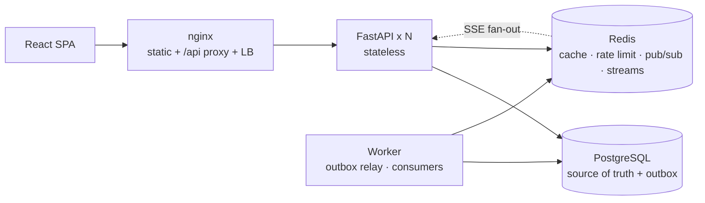

# Lux Delivery

**Food delivery platform: menu, orders with real-time tracking, notifications and an operations dashboard.**
A FastAPI **modular monolith** on PostgreSQL + Redis, an async **worker** fed by a **transactional
outbox**, and a React + TypeScript SPA. It is load-tested and observable, and comes with a
system-design write-up that walks from 10 to 10 million users.

[](.github/workflows/ci.yml)


> 🇧🇷 Versão em português: [README.pt-BR.md](README.pt-BR.md) · Full documentation (pt-BR): [docs/](docs/README.md)

| Customer: live order tracking | Admin: operations dashboard |
|---|---|
|  |  |

## Run it (one command)

```bash
docker compose up --build
```

| URL | What |
|---|---|
| http://localhost:8080 | the app (demo users: `cliente@lux.dev` / `Cliente@12345`, `admin@lux.dev` / `Admin@12345`) |
| http://localhost:8000/docs | Swagger UI |
| http://localhost:3001 | Grafana (with `-f docker-compose.observability.yml`) |

The stack applies migrations and seeds 60 days of realistic orders (lunch/dinner peaks, a few
cancellations), so the dashboard has data from the first minute.

## What is interesting here

| Topic | What was done | Proof |
|---|---|---|
| **Consistency** | `Idempotency-Key` on checkout (unique index as the lock), `SELECT … FOR UPDATE` on status transitions, transactional outbox, idempotent consumers, dead-letter queue | concurrency tests: 8 simultaneous retries create 1 order; racing transitions always serialise |
| **Real time** | SSE fed by Redis Pub/Sub through **one subscription per process**: works across N replicas with no sticky sessions | end-to-end test against a real uvicorn server |
| **Data modelling** | money as `NUMERIC`, `BIGINT` where volume grows, price/name snapshots, partial and composite indexes justified query by query | `alembic check` in CI (no model/schema drift), a query-**plan** regression test |
| **Security** | HttpOnly cookies, refresh-token rotation with family revocation on reuse, per-account login limiting, IDOR-safe 404s, upload re-encoding | STRIDE table in [docs/05](docs/05-seguranca.md), each control tied to a test |
| **Performance** | measured with k6, profiled with py-spy; 4 real bottlenecks found and fixed | [docs/09](docs/09-testes-de-carga.md): 1 → 3 replicas took read p95 from 350 ms to **7 ms** at 500 RPS |
| **Operations** | JSON logs with request ids, RED metrics by route template, 9 alerts with runbooks, liveness vs readiness, load shedding, zero-downtime deploy script (verified under traffic) | [docs/10](docs/10-observabilidade-e-runbooks.md) |
| **Scaling story** | 7 stages from 1–10 to 10M+ daily users, with capacity math, what breaks first, costs and a hands-on tutorial | [docs/07](docs/07-escalabilidade/README.md), [docs/08](docs/08-federacao-sharding-e-microservicos.md) |
| **Contract safety** | frontend types generated from OpenAPI; CI fails if API and web drift | `contract` job |

## Architecture



```text
apps/api/app/
├── core/       config, db, redis, security, errors, middleware, cache, rate limit, outbox, realtime hub
├── modules/    identity · catalog · ordering · notifications · analytics · realtime   (bounded contexts)
└── workers/    outbox relay (LISTEN/NOTIFY + SKIP LOCKED) · Redis Streams consumer groups · maintenance
apps/web/src/
├── app/        router, providers, realtime (EventSource with backoff)
├── features/   auth · catalog · cart · orders · notifications · profile · admin
└── shared/     api client + generated OpenAPI types, ui, layout, lib
```

## Repository layout

```text
apps/api            FastAPI service (tests: apps/api/tests, 145 tests, 91% coverage)
apps/web            React + TypeScript SPA (55 tests)
docs/               architecture, data model, API, security, scaling tutorial, load tests, ADRs
infra/              nginx, Prometheus/alerts, Grafana dashboard, k8s manifests, single-node prod
loadtest/k6         k6 scenarios (browse, checkout) and raw results
scripts/            backup/restore, zero-downtime deploy, screenshot capture
docker-compose*.yml dev stack + overlays: scale, observability, loadtest, s3
```

## Development

```bash
# backend
cd apps/api && python -m venv .venv && .venv/Scripts/pip install -r requirements-dev.txt   # (bin/ on Linux/macOS)
docker compose up -d db redis          # tests use real Postgres and Redis
pytest                                 # 145 tests, ~20 s
ruff check . && ruff format --check .

# frontend
cd apps/web && npm ci
npm run dev                            # http://localhost:3000 (proxies /api to :8000)
npm run lint && npm run typecheck && npm test && npm run build

# API contract -> frontend types
cd apps/api && python -m app.scripts.export_openapi ../web/openapi.json && cd ../web && npm run gen:api
```

## Overlays

```bash
docker compose -f docker-compose.yml -f docker-compose.scale.yml up -d          # nginx + 3 API replicas + PgBouncer
docker compose -f docker-compose.yml -f docker-compose.observability.yml up -d  # Prometheus + Grafana + exporters
docker compose -f docker-compose.yml -f docker-compose.loadtest.yml run --rm k6 run /scripts/browse.js
docker compose -f docker-compose.yml -f docker-compose.s3.yml up -d             # images on S3-compatible storage
```

## License
MIT
