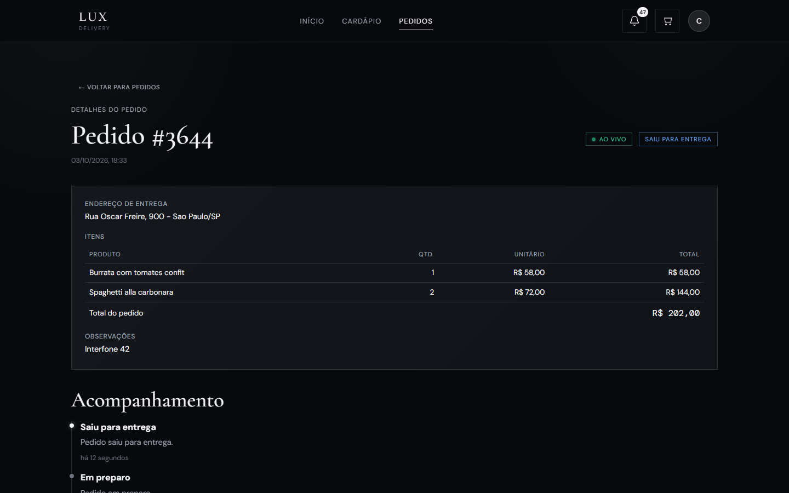
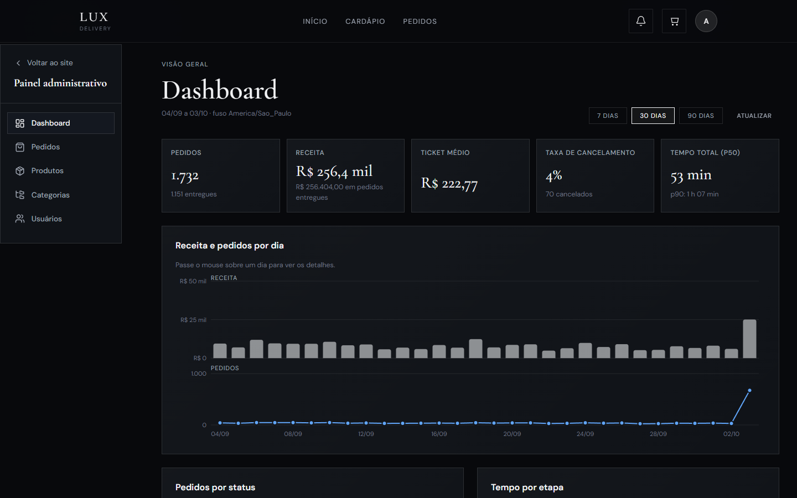
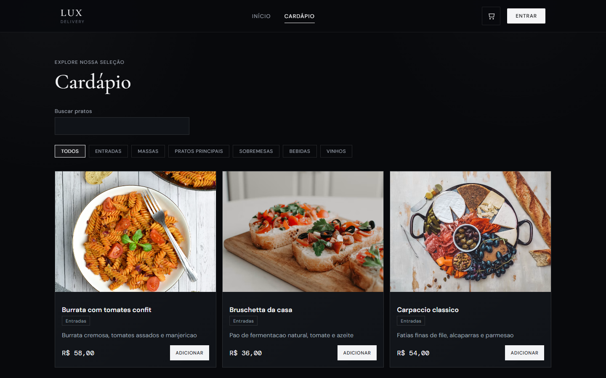
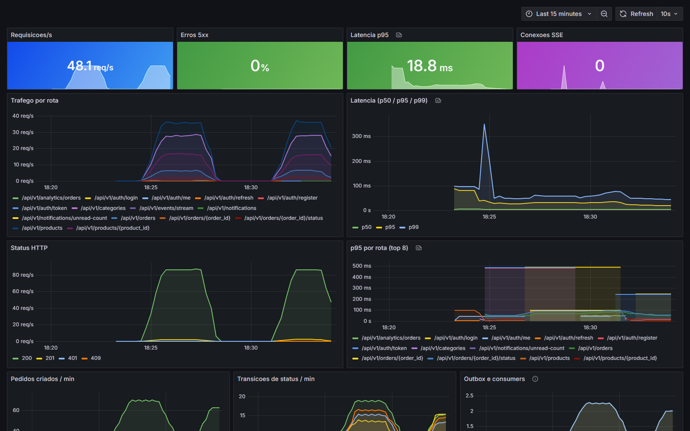

# Lux Delivery

**Plataforma de delivery: cardápio, pedidos com rastreio em tempo real, notificações e painel de operação.**
Monólito modular em FastAPI sobre PostgreSQL + Redis, com um **worker** assíncrono alimentado por
**transactional outbox** e um SPA React + TypeScript. Tem teste de carga, observabilidade e
documentação de system design de 10 a 10 milhões de usuários.

> 🇺🇸 English: [README.md](README.md) · Documentação completa: [docs/](docs/README.md)

| Cliente: pedido em tempo real | Admin: painel de operação |
|---|---|
|  |  |

| Cardápio | Grafana (tráfego sintético do k6) |
|---|---|
|  |  |

## Rodando (um comando)

```bash
docker compose up --build
```

| Endereço | O quê |
|---|---|
| http://localhost:8080 | a aplicação. Usuários de demonstração: `cliente@lux.dev` / `Cliente@12345` e `admin@lux.dev` / `Admin@12345` |
| http://localhost:8000/docs | Swagger |
| http://localhost:3001 | Grafana (com `-f docker-compose.observability.yml`) |

As migrations rodam sozinhas e o seed gera 60 dias de pedidos realistas (picos no almoço e no jantar,
alguns cancelamentos), então o dashboard tem dados desde o primeiro minuto.

**Para ver o tempo real:** abra o app em duas janelas, uma como cliente (faça um pedido) e outra como
admin (`/admin/orders`, avance o status). A tela do cliente atualiza sozinha.

## O que há de interessante

| Tema | O que foi feito | Evidência |
|---|---|---|
| **Consistência** | `Idempotency-Key` no checkout (índice único como lock), `SELECT … FOR UPDATE` nas transições, outbox transacional, consumers idempotentes, dead-letter | testes de concorrência: 8 retries simultâneos criam 1 pedido; transições concorrentes sempre serializam |
| **Tempo real** | SSE alimentado por Redis Pub/Sub com **uma assinatura por processo**; funciona com N réplicas sem sticky session | teste ponta a ponta contra um uvicorn real |
| **Modelagem** | dinheiro em `NUMERIC`, `BIGINT` onde o volume cresce, snapshot de preço e nome, índices parciais e compostos justificados query a query | `alembic check` no CI (zero drift), teste de regressão de **plano** de query |
| **Segurança** | cookies HttpOnly, rotação de refresh com revogação da família em caso de reuso, limite de login por conta, 404 contra IDOR, recodificação de uploads | tabela STRIDE em [docs/05](docs/05-seguranca.md), cada controle ligado a um teste |
| **Performance** | medido com k6, perfilado com py-spy; 4 gargalos reais encontrados e corrigidos | [docs/09](docs/09-testes-de-carga.md): de 1 para 3 réplicas, p95 de leitura caiu de 350 ms para **7 ms** a 500 RPS |
| **Operação** | logs JSON com request id, métricas RED por template de rota, 9 alertas com runbook, liveness vs readiness, load shedding, deploy sem downtime (verificado sob tráfego) | [docs/10](docs/10-observabilidade-e-runbooks.md) |
| **Escala** | 7 estágios de 1–10 a 10 M+ usuários/dia, com contas de capacidade, o que quebra primeiro, custos e tutorial prático | [docs/07](docs/07-escalabilidade/README.md), [docs/08](docs/08-federacao-sharding-e-microservicos.md) |
| **Contrato** | tipos do front gerados do OpenAPI; o CI falha se API e web divergirem | job `contract` |

## Estrutura

```text
apps/api            serviço FastAPI (145 testes, 91% de cobertura)
apps/web            SPA React + TypeScript (55 testes)
docs/               arquitetura, modelagem, API, segurança, tutorial de escala, testes de carga, ADRs
infra/              nginx, Prometheus/alertas, dashboard Grafana, manifests k8s, produção em nó único (Caddy + backup)
loadtest/k6         cenários k6 (navegação, checkout) e resultados brutos
scripts/            backup/restore, deploy sem downtime, captura de screenshots
docker-compose*.yml stack de dev + overlays: scale, observability, loadtest, s3
```

## Desenvolvimento

```bash
# backend
cd apps/api && python -m venv .venv && .venv/Scripts/pip install -r requirements-dev.txt   # bin/ no Linux/macOS
docker compose up -d db redis          # os testes usam Postgres e Redis reais
pytest                                 # 145 testes, ~20 s
ruff check . && ruff format --check .

# frontend
cd apps/web && npm ci
npm run dev                            # http://localhost:3000 (faz proxy de /api para :8000)
npm run lint && npm run typecheck && npm test && npm run build
```

## Licença
MIT
