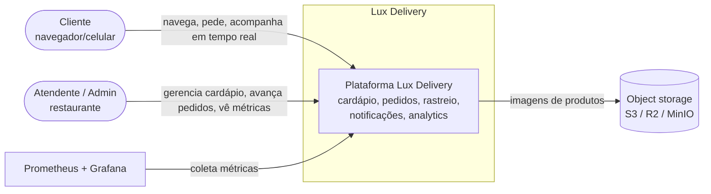
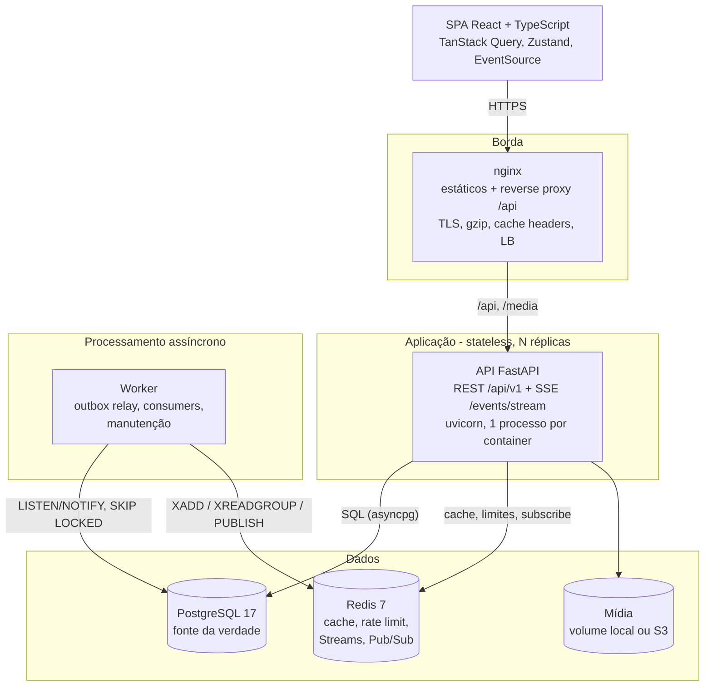
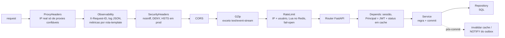
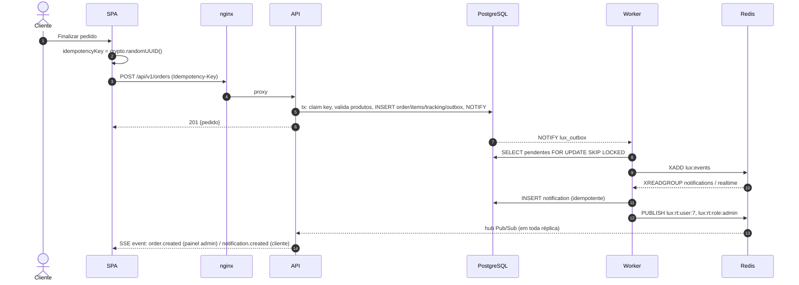
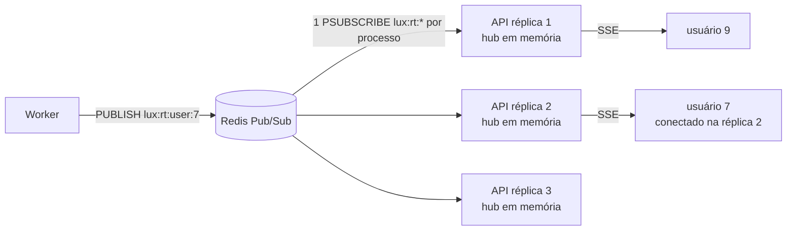

# 02 — Arquitetura

> **Em uma frase:** um **monólito modular** em FastAPI (API stateless + worker assíncrono) sobre
> PostgreSQL (fonte da verdade) e Redis (cache, rate limit, streams, pub/sub), com um SPA React servido
> pelo mesmo nginx que faz proxy da API. Ele roda num único `docker compose up` e escala horizontalmente
> sem mudar código.

## 1. Contexto (C4, nível 1)



## 2. Containers (C4, nível 2)



| Container | Tecnologia | Responsabilidade | Estado |
|---|---|---|---|
| Web | React 18, Vite, TS, TanStack Query | UI do cliente e do admin; tempo real via `EventSource` | nenhum (cookies HttpOnly) |
| nginx | nginx 1.27 | estáticos com cache imutável, proxy same-origin de `/api`, balanceamento entre réplicas, SSE sem buffer | nenhum |
| API | FastAPI 0.131, SQLAlchemy 2 async, asyncpg, Pydantic 2 | regras de negócio síncronas, autenticação, SSE | **nenhum**: pode morrer e escalar à vontade |
| Worker | mesmo código (`python -m app.workers`) | outbox → Streams, notificações, fan-out em tempo real, limpeza | nenhum (offsets ficam no Redis) |
| PostgreSQL | 17 | dados transacionais, outbox, idempotência | **durável** |
| Redis | 7.4 | cache, rate limit, status de usuário, Streams, Pub/Sub | efêmero (o outbox é a cópia durável dos eventos) |

**Por que same-origin (nginx servindo front e API)?** Com front e API no mesmo domínio, não existe
preflight CORS em cada request e os cookies podem ser `SameSite=Strict`, o que é a principal defesa
contra CSRF. TLS, compressão e balanceamento ficam num lugar só.

## 3. Componentes da API (C4, nível 3): monólito modular

```text
apps/api/app/
├── main.py                 # app factory: middlewares, routers, lifespan
├── models.py               # registro de todos os models (Alembic/testes)
├── core/                   # infraestrutura compartilhada, SEM regra de negócio
│   ├── config.py           #   settings tipados (pydantic-settings), guarda de produção
│   ├── database.py         #   engine async, sessão, naming convention, PgBouncer mode
│   ├── redis.py            #   pool compartilhado + conexões dedicadas (pub/sub, streams)
│   ├── security.py         #   bcrypt em thread, JWT com issuer/type/jti
│   ├── errors.py           #   erros de domínio -> HTTP (detail, code, request_id)
│   ├── middleware.py       #   ASGI puro: request-id/log/métricas, headers, rate limit
│   ├── rate_limit.py       #   janela deslizante em Lua (atômica)
│   ├── cache.py            #   cache-aside, namespace versionado, single-flight
│   ├── pagination.py       #   cursor keyset opaco + Page[T]
│   ├── outbox.py           #   tabela outbox + enqueue transacional + NOTIFY
│   ├── realtime.py         #   hub Pub/Sub: 1 assinatura por processo, fan-out local
│   ├── metrics.py          #   métricas Prometheus (RED + negócio)
│   └── health.py           #   /health/live, /health/ready (inclui versão da migration), /metrics
├── modules/                # um pacote por bounded context
│   ├── identity/           #   usuários, login, refresh rotativo, RBAC
│   ├── catalog/            #   categorias, produtos, imagens (porta Storage: local | S3)
│   │   └── public.py       #   <- única porta que outros módulos podem usar
│   ├── ordering/           #   pedidos, máquina de estados (domain.py puro), idempotência
│   ├── notifications/      #   notificações + consumer de eventos
│   ├── analytics/          #   agregações SQL (p50/p90, série diária, top produtos)
│   └── realtime/           #   endpoint SSE + consumer de fan-out
├── workers/                # processo separado: relay do outbox, consumer groups, manutenção
└── scripts/                # seed, export do contrato OpenAPI
```

Cada módulo segue a mesma divisão em camadas:

| Arquivo | Conhece HTTP? | Conhece SQL? | Responsabilidade |
|---|---|---|---|
| `router.py` | sim | não | parse/validação (Pydantic), dependências de auth, status codes |
| `service.py` | **não** | via repositório | casos de uso, unidade de trabalho (`commit`), efeitos pós-commit |
| `repository.py` | não | sim | queries; nunca faz `commit` |
| `domain.py` | não | não | regras puras (máquina de estados, cálculo de totais) |
| `models.py` / `schemas.py` | não | ORM / não | persistência / contrato da API |

**Regras de dependência:** `core` não importa `modules`; um módulo só importa outro pela interface
pública (`catalog/public.py`, `identity/dependencies.py`); serviços lançam erros de domínio
(`NotFound`, `Conflict`…), nunca `HTTPException`. É isso que permite reaproveitar os serviços no
worker e testá-los sem servidor HTTP.

**Por que monólito modular e não microserviços?** O ADR-0001 desenvolve. Em resumo: um time pequeno,
um domínio coeso e transações que cruzam catálogo e pedidos. Microserviços trariam rede, consistência
eventual e deploy distribuído antes de existir um problema que eles resolvam. As fronteiras de
módulo, o outbox e a porta `public.py` deixam a extração barata quando (e se) ela fizer sentido
(estágio 6).

## 4. Ciclo de vida de uma request



- Os middlewares são **ASGI puros**. O `BaseHTTPMiddleware` do Starlette bufferiza respostas e
  quebra o streaming de SSE, além de adicionar overhead por request.
- O `request_id` (vindo do nginx ou gerado) vai para o contexto (`contextvars`), aparece em toda
  linha de log, no header de resposta e no corpo dos erros. Um usuário que manda o print de um erro
  500 dá o id exato para buscar nos logs.
- Métricas usam o **template** da rota (`/api/v1/orders/{order_id}`), não o path cru, para manter a
  cardinalidade das séries limitada.

## 5. Fluxos principais

### 5.1 Checkout com idempotência e notificação em tempo real


### 5.2 Login, refresh e detecção de roubo de token
```mermaid
sequenceDiagram
    autonumber
    participant B as Navegador
    participant A as API
    participant P as PostgreSQL
    B->>A: POST /auth/login {email, senha}
    A->>A: rate limit por IP e por conta; bcrypt em thread
    A->>P: INSERT refresh_tokens(family=F, jti_hash=H1)
    A-->>B: Set-Cookie lux_access (15 min, Path=/), lux_refresh (7 d, Path=/api/v1/auth), HttpOnly, SameSite=Strict
    Note over B,A: 15 minutos depois, uma request recebe 401
    B->>A: POST /auth/refresh (cookie H1)
    A->>P: SELECT ... FOR UPDATE; revoga H1 (replaced_by=H2); INSERT H2 (família F)
    A-->>B: novos cookies
    Note over B,A: um atacante reapresenta H1 (roubado)
    B->>A: POST /auth/refresh (cookie H1)
    A->>P: H1 já rotacionado fora da janela de graça -> UPDATE ... SET revoked_at WHERE family=F
    A-->>B: 401 refresh_token_reused (todos os dispositivos da família deslogados)
```

### 5.3 Tempo real com N réplicas

O usuário pode estar conectado em qualquer réplica, e o worker não precisa saber em qual. Cada
réplica mantém **uma** assinatura no Redis (e não uma por usuário), então as conexões com o Redis
crescem com o número de pods, não com o número de usuários online. Mensagens de tempo real são
**dicas** ("o pedido 42 mudou"); a fonte da verdade continua sendo o REST, que o front reconsulta.

## 6. Visão de implantação

| Ambiente | Como sobe | Topologia |
|---|---|---|
| Desenvolvimento | `docker compose up` | 1 API, 1 worker, Postgres, Redis, nginx + SPA, seed automático |
| Escala local | `+ docker-compose.scale.yml` | nginx → 3 réplicas da API → PgBouncer → Postgres |
| Observabilidade | `+ docker-compose.observability.yml` | Prometheus (descoberta por DNS), Grafana, exporters |
| Carga | `+ docker-compose.loadtest.yml` | k6 dentro da rede do compose |
| Produção (exemplo) | `kubectl apply -k infra/k8s` | Deployments + HPA + PDB + Ingress; Postgres/Redis gerenciados |

## 7. Decisões de stack (resumo)

| Escolha | Alternativas consideradas | Por que esta |
|---|---|---|
| FastAPI + asyncio | Django, Flask, NestJS | I/O-bound (DB, Redis, SSE); tipagem com Pydantic; OpenAPI gratuito |
| SQLAlchemy 2 async + asyncpg | ORM síncrono, SQL cru | o driver mais rápido de Python, com ORM para CRUD e SQL cru onde importa (analytics) |
| PostgreSQL | MySQL, Mongo | transações, `SKIP LOCKED`, índices parciais/funcionais, `percentile_cont`, `LISTEN/NOTIFY` |
| Redis Streams | Kafka, RabbitMQ, SQS | já está na stack; consumer groups + ack bastam para o volume (ADR-0004) |
| SSE | WebSocket, long polling | tráfego só servidor → cliente; HTTP comum; reconexão nativa (ADR-0005) |
| Cookies HttpOnly | Bearer no localStorage | XSS não consegue ler o token (ADR-0003) |
| Monólito modular | microserviços | ver ADR-0001 |
