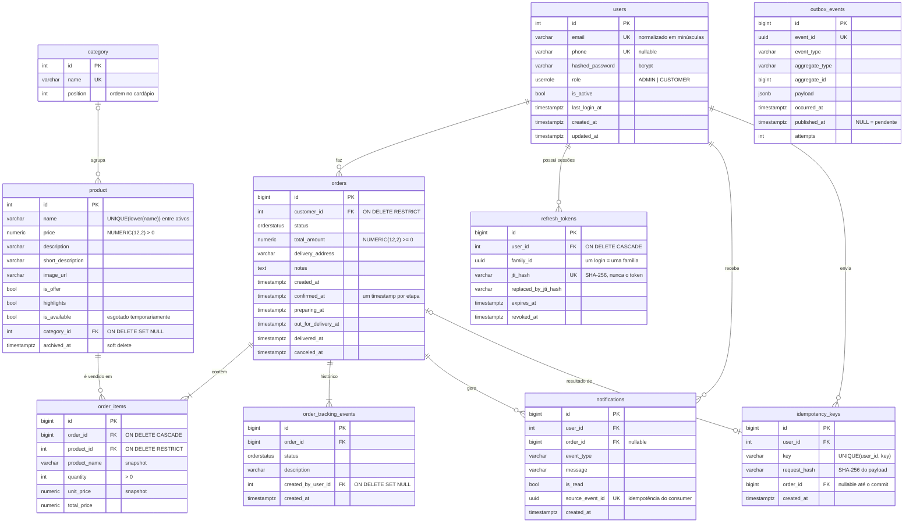
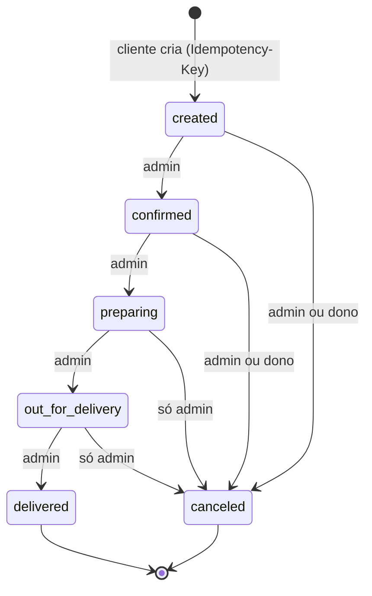

# 03 — Modelagem de dados

> **Resumo:** PostgreSQL é a fonte da verdade. O schema é normalizado (3FN) no
> núcleo transacional, com **duas desnormalizações deliberadas** (snapshot de preço/nome no item e
> timestamps de status no pedido). Dinheiro é `NUMERIC(12,2)`, tabelas de alto volume usam `BIGINT`,
> toda regra que o banco consegue garantir é garantida pelo banco (FK, CHECK, UNIQUE parcial), e
> cada índice existe por causa de uma query específica, listada abaixo.

## Sumário

1. [Diagrama entidade-relacionamento](#1-diagrama-entidade-relacionamento)
2. [Bounded contexts e donos das tabelas](#2-bounded-contexts-e-donos-das-tabelas)
3. [Dicionário de dados](#3-dicionário-de-dados)
4. [Decisões de modelagem (e o porquê)](#4-decisões-de-modelagem-e-o-porquê)
5. [Índices: cada um serve uma query](#5-índices-cada-um-serve-uma-query)
6. [Máquina de estados do pedido](#6-máquina-de-estados-do-pedido)
7. [Integridade: o que o banco garante sozinho](#7-integridade-o-que-o-banco-garante-sozinho)
8. [Volume, crescimento e retenção](#8-volume-crescimento-e-retenção)
9. [Evolução do schema (migrations)](#9-evolução-do-schema-migrations)
10. [Como o modelo muda quando o sistema cresce](#10-como-o-modelo-muda-quando-o-sistema-cresce)

---

## 1. Diagrama entidade-relacionamento



`outbox_events` não tem FK para `orders` de propósito: é uma fila técnica, genérica para qualquer
agregado, e é limpa pelo worker depois de 7 dias.

## 2. Bounded contexts e donos das tabelas

O backend é um **monólito modular**: cada módulo é dono das suas tabelas, e outro módulo só lê dados
alheios pela interface pública do dono (por exemplo, `catalog/public.py`). Essa disciplina é o que
torna possível, mais tarde, separar o banco por domínio. Isso é a *federação funcional*, discutida
em [08](08-federacao-sharding-e-microservicos.md).

| Módulo (`app/modules/…`) | Tabelas | Quem lê de fora e como |
|---|---|---|
| `identity` | `users`, `refresh_tokens` | Todos, via `Principal` (id + papel), nunca a tabela |
| `catalog` | `category`, `product` | `ordering`, via `get_orderable_products()` |
| `ordering` | `orders`, `order_items`, `order_tracking_events`, `idempotency_keys` | `analytics` (SQL de leitura) |
| `notifications` | `notifications` | ninguém (alimentada por eventos) |
| infraestrutura (`core/outbox.py`) | `outbox_events` | worker (relay) |

## 3. Dicionário de dados

### `users`
| Coluna | Tipo | Regra | Observação |
|---|---|---|---|
| `id` | `INTEGER` PK | identidade | 2,1 bi de usuários é suficiente; ver [§4.2](#42-integer-vs-bigint) |
| `email` | `VARCHAR(120)` | `UNIQUE` | normalizado para minúsculas na entrada (schema Pydantic) |
| `phone` | `VARCHAR(25)` | `UNIQUE`, nullable | `UNIQUE` ignora `NULL`s no Postgres, então vários usuários sem telefone convivem |
| `hashed_password` | `VARCHAR(255)` | not null | bcrypt cost 12 (~200 ms), calculado fora do event loop |
| `role` | enum `userrole` | `ADMIN`/`CUSTOMER` | o papel vale do banco, não do JWT (rebaixamento tem efeito imediato) |
| `is_active` | `BOOLEAN` | default `true` | desativação invalida o cache de status e revoga as sessões |

### `product`
| Coluna | Tipo | Regra | Observação |
|---|---|---|---|
| `price` | `NUMERIC(12,2)` | `CHECK (price > 0)` | exato; `FLOAT` daria `0.1 + 0.2 = 0.30000000000000004` |
| `name` | `VARCHAR(100)` | `UNIQUE (lower(name)) WHERE archived_at IS NULL` | índice funcional **parcial**: “Pizza” e “pizza” colidem, mas um nome arquivado pode ser reutilizado |
| `is_available` | `BOOLEAN` | default `true` | esgotado hoje; o produto continua no cardápio |
| `archived_at` | `TIMESTAMPTZ` | nullable | *soft delete*: some do cardápio, mas os pedidos antigos continuam apontando para ele |
| `category_id` | `INTEGER` FK | `ON DELETE SET NULL` | apagar uma categoria não apaga produtos |

### `orders`
| Coluna | Tipo | Regra | Observação |
|---|---|---|---|
| `id` | `BIGINT` PK | identidade | tabela de alto volume |
| `customer_id` | `INTEGER` FK | `ON DELETE RESTRICT` | não se apaga cliente com pedidos (histórico fiscal); LGPD é tratada por **anonimização** |
| `status` | enum `orderstatus` | máquina de estados na aplicação | ver [§6](#6-máquina-de-estados-do-pedido) |
| `total_amount` | `NUMERIC(12,2)` | `CHECK (>= 0)` | soma dos itens, calculada em `Decimal` com `ROUND_HALF_UP` |
| `*_at` | `TIMESTAMPTZ` | nullable | um timestamp por etapa; alimenta o SLA (p50/p90) sem `JOIN` |

### `order_items`
| Coluna | Tipo | Regra | Observação |
|---|---|---|---|
| `product_name`, `unit_price` | snapshot | not null | **preço e nome no momento da compra**; mudar o cardápio não reescreve a história |
| `quantity` | `INTEGER` | `CHECK (> 0)` | linhas repetidas do mesmo produto são fundidas na entrada |
| `product_id` | FK | `ON DELETE RESTRICT` | combinado com o soft delete, garante que o produto de um pedido nunca some |

### `order_tracking_events`
Log **append-only** de transições (quem, quando, para qual status). É auditoria, e também a linha
do tempo que o cliente vê na tela.

### `notifications`
`source_event_id` (UUID do evento de outbox que gerou a linha) é `UNIQUE`: se o consumer receber
o mesmo evento duas vezes (entrega *at-least-once*), o `INSERT … ON CONFLICT DO NOTHING` descarta a
duplicata.

### `refresh_tokens`
Guarda apenas o **SHA-256 do `jti`**, e não o token: um vazamento do banco não entrega sessões
válidas. `family_id` agrupa todas as rotações de um mesmo login; reapresentar um token já rotacionado
revoga a família inteira (detecção de roubo de token).

### `idempotency_keys`
`UNIQUE (user_id, key)` funciona ao mesmo tempo como **dedup** e como **lock**: um segundo
`INSERT` concorrente da mesma chave espera o primeiro terminar (ver [06](06-concorrencia-e-consistencia.md)).
`request_hash` impede reutilizar a chave com outro conteúdo. As linhas expiram em 24 h.

### `outbox_events`
Fila transacional. `published_at IS NULL` significa pendente. `attempts`/`last_error` guardam o
histórico de falhas de publicação no Redis.

## 4. Decisões de modelagem (e o porquê)

### 4.1 Dinheiro é `NUMERIC`, nunca `FLOAT`
O schema original tinha `price REAL` e `total_amount DOUBLE PRECISION` no banco, enquanto o ORM
declarava `Numeric`: um *drift* silencioso. Ponto flutuante binário não representa `0.10`, então
somas de centavos acumulam erro. A migration de correção converte com `round(col::numeric, 2)` e um
teste de regressão garante `3 × 33.33 + 3 × 0.10 = 100.29` exatos.

### 4.2 `INTEGER` vs `BIGINT`
| Tabela | Tipo do id | Raciocínio |
|---|---|---|
| `users`, `product`, `category` | `INTEGER` | crescem com o negócio, não com o tráfego; 2,1 bi é inalcançável |
| `orders`, `order_items`, `order_tracking_events`, `notifications`, `refresh_tokens`, `outbox_events`, `idempotency_keys` | `BIGINT` | crescem com o **tráfego**: 5 eventos de tracking e ~5 notificações por pedido |

Conta de bolso: com 1 M pedidos/dia, `order_tracking_events` recebe ~5 M linhas/dia e esgota o
`INTEGER` em ~430 dias. Trocar o tipo de uma PK depois exige reescrever a tabela e todos os índices
(horas de lock ou uma migração online complexa). Fazer isso cedo custa 4 bytes por linha. Detalhe
fácil de esquecer: a **sequence** também precisa de `ALTER SEQUENCE … AS bigint`, senão ela continua
limitada a 2³¹.

### 4.3 Snapshot no item (desnormalização deliberada)
`order_items.product_name` e `unit_price` duplicam dados do produto. É de propósito: um pedido é
um **documento histórico**. Se o preço sobe amanhã, o pedido de ontem não pode mudar. Normalizar
aqui seria um bug, não uma virtude.

### 4.4 Timestamps por etapa no pedido (desnormalização deliberada)
`confirmed_at … delivered_at` repetem informação que existe em `order_tracking_events`. O custo são
5 colunas nulas; o ganho é calcular SLA (p50/p90 de cada etapa) com uma varredura simples de
`orders`, sem `JOIN` nem *pivot* do log de eventos.

### 4.5 Soft delete só onde há histórico
`product` tem `archived_at` porque é referenciado por pedidos. `category` é apagada de verdade
(`ON DELETE SET NULL` nos produtos). `users` não é apagado (é `RESTRICT`); para LGPD o caminho é
anonimizar nome, e-mail e telefone mantendo o id.

### 4.6 Enum no banco vs tabela de status
Os status do pedido são um enum nativo do Postgres (`orderstatus`): 4 bytes, validado pelo banco e
legível em SQL. A desvantagem é que adicionar um valor exige `ALTER TYPE … ADD VALUE`, uma migration.
Para um conjunto pequeno e estável de status, compensa. Se o negócio precisar de status
configuráveis por restaurante, o caminho é migrar para uma tabela de referência.

### 4.7 O que ficou fora do banco relacional
| Dado | Onde | Por quê |
|---|---|---|
| Cache do cardápio e de analytics | Redis (TTL + namespace versionado) | derivado, pode ser perdido |
| Status do usuário (ativo, papel) | Redis, TTL 5 min, invalidado na mudança | lido em toda request autenticada |
| Rate limit | Redis (sorted sets) | efêmero, alta taxa de escrita |
| Eventos em trânsito | Redis Streams | o outbox no Postgres é a cópia durável |
| Imagens | disco local ou S3 | binários não pertencem ao banco |

## 5. Índices: cada um serve uma query

O Postgres não cria índice para FK automaticamente, e cada índice encarece toda escrita. A regra
adotada: **nenhum índice sem uma query que o justifique**. A versão anterior tinha um `ix_<tabela>_id`
em toda PK (redundante, porque a PK já é um índice) e índices em colunas que nenhuma query filtrava.
Todos foram removidos.

| Índice | Definição | Query servida |
|---|---|---|
| `ix_orders_customer_created` | `(customer_id, created_at, id)` | "Meus pedidos", mais novos primeiro, com cursor keyset: `WHERE customer_id = $1 AND (created_at, id) < ($2, $3) ORDER BY created_at DESC, id DESC LIMIT 21` |
| `ix_orders_status_created` | `(status, created_at, id)` | Quadro da cozinha/admin filtrado por status |
| `ix_orders_created_at` | `(created_at)` | Analytics por período (range scan) |
| `ix_order_items_order_id` | `(order_id)` | Carregar os itens de um pedido (`selectinload`) |
| `ix_order_items_product_id` | `(product_id)` | Top produtos; e o `RESTRICT` da FK checa por aqui |
| `ix_order_tracking_events_order_id` | `(order_id, id)` | Linha do tempo de um pedido, já ordenada |
| `ix_notifications_user_created` | `(user_id, created_at, id)` | Lista de notificações paginada |
| `ix_notifications_user_unread` | `(user_id) WHERE is_read = false` | Badge de não lidas: índice **parcial**, só tem as linhas não lidas, que são poucas |
| `ix_product_category_active` | `(category_id) WHERE archived_at IS NULL` | Cardápio por categoria (só ativos) |
| `uq_product_name_active` | `UNIQUE (lower(name)) WHERE archived_at IS NULL` | Regra de negócio + busca por nome |
| `ix_refresh_tokens_family_id` | `(family_id)` | Revogar a família inteira na detecção de reuso |
| `ix_refresh_tokens_user_active` | `(user_id) WHERE revoked_at IS NULL` | "Encerrar todas as sessões" (troca de senha, desativação) |
| `uq_idempotency_keys_user_key` | `UNIQUE (user_id, key)` | Dedup + lock de requisições repetidas |
| `ix_idempotency_keys_created_at` | `(created_at)` | Limpeza de chaves com mais de 24 h |
| `ix_outbox_events_unpublished` | `(id) WHERE published_at IS NULL` | Relay: `ORDER BY id LIMIT 100 FOR UPDATE SKIP LOCKED`; o índice parcial fica pequeno mesmo com dias de histórico publicado |

**FK sem índice, de propósito:** `notifications.order_id`. Nenhuma query filtra notificações por
pedido, e pedidos nunca são apagados (o `CASCADE` existe só por correção). Um índice aqui só
encareceria cada `INSERT` de notificação.

**Por que a ordem `(customer_id, created_at, id)`:** igualdade primeiro (`customer_id`), depois as
colunas de ordenação. O Postgres percorre o B-tree **de trás para frente** para servir
`ORDER BY created_at DESC, id DESC`, então não é preciso declarar `DESC` no índice. O `id` desempata
pedidos criados no mesmo microssegundo e torna o cursor estável.

### Validando com `EXPLAIN` (e o bug que ele encontrou)

Medido com 100 mil pedidos (`seed --orders 100000`), cliente com ~2.400 pedidos, página profunda:

```sql
-- Forma 1: OR expandido (a primeira versão do código)
WHERE customer_id = 7
  AND (created_at < $x OR (created_at = $x AND id < $y))
ORDER BY created_at DESC, id DESC LIMIT 21;
--   Index Scan Backward using ix_orders_customer_created
--     Index Cond: (customer_id = 7)
--     Rows Removed by Filter: 1599          <- leu e descartou 1.599 linhas
--   Execution Time: 8.05 ms                 <- cresce com a profundidade, como um OFFSET

-- Forma 2: comparação de tupla (row value)
WHERE customer_id = 7 AND (created_at, id) < ($x, $y)
ORDER BY created_at DESC, id DESC LIMIT 21;
--   Index Scan Backward using ix_orders_customer_created
--     Index Cond: ((customer_id = 7) AND (ROW(created_at, id) < ROW($x, $y)))
--   Execution Time: 0.21 ms                 <- constante em qualquer página
```

As duas formas são logicamente equivalentes, mas só a segunda vira **condição de índice**: o
planner não converte o `OR` num limite do B-tree. O código passou a usar
`tuple_(Order.created_at, Order.id) < tuple_(x, y)`, e o teste
`test_keyset_pagination_is_an_index_condition` faz `EXPLAIN` da query gerada pelo repositório e
falha se o cursor deixar de aparecer no `Index Cond`. É um teste de regressão de **plano**, não só
de resultado.

Para comparação, o `OFFSET 2000` equivalente fez *Bitmap Heap Scan* + *Sort* de 2.327 linhas
(5,4 ms) para devolver 21. Outros planos medidos:

| Query | Plano | Tempo |
|---|---|---|
| Meus pedidos, página 1 | `Index Scan Backward using ix_orders_customer_created` | 0,5 ms |
| Quadro admin, `status = PREPARING` | `Index Scan Backward using ix_orders_status_created` | 0,1 ms |
| Relay do outbox (fila vazia) | `ix_outbox_events_unpublished` / seq scan em tabela vazia | 0,1 ms |

## 6. Máquina de estados do pedido



As regras vivem em `app/modules/ordering/domain.py`, código puro sem FastAPI nem SQLAlchemy, coberto
por testes unitários que rodam em milissegundos. A aplicação garante a máquina de estados, e a
concorrência é resolvida pelo banco: `SELECT … FOR UPDATE` serializa duas transições do mesmo pedido,
e a segunda revalida contra o status **já atualizado** (detalhes em [06](06-concorrencia-e-consistencia.md)).

Por que não um `CHECK`/trigger no banco? Transições dependem de **quem** age (cliente vs admin), e
essa informação não está na linha. Um trigger poderia validar só o grafo de transições; a decisão foi
manter a regra num único lugar testável e registrar cada transição em `order_tracking_events`.

## 7. Integridade: o que o banco garante sozinho

Validação na API é para dar boas mensagens de erro. Garantia de verdade é constraint no banco, porque
scripts, migrations e workers não passam pela API.

| Regra de negócio | Mecanismo no Postgres |
|---|---|
| Preço positivo, total não negativo, quantidade > 0 | `CHECK` |
| E-mail único, telefone único (quando existe) | `UNIQUE` |
| Nome de produto único entre os ativos, sem diferenciar maiúsculas | `UNIQUE` funcional **parcial** |
| Pedido não perde o produto | FK `RESTRICT` + soft delete |
| Apagar categoria não apaga produtos | FK `SET NULL` |
| Notificação não duplica sob reentrega | `UNIQUE (source_event_id)` |
| Mesma Idempotency-Key não gera dois pedidos | `UNIQUE (user_id, key)` |
| Constraints com nomes previsíveis | `naming_convention` no `MetaData` (testado) |

## 8. Volume, crescimento e retenção

Tamanho médio medido no banco de demonstração (1.501 pedidos, com índices): **~1,5 KB por pedido**
somando `orders` (552 kB) + `order_items` (576 kB) + `order_tracking_events` (1.088 kB). Com
notificações e folga para bloat, a conta usa **2 KB/pedido**:

| Pedidos/dia | Crescimento/dia | Por ano | Observação |
|---|---|---|---|
| 1 mil | 2 MB | ~0,7 GB | cabe na RAM de qualquer servidor |
| 100 mil | 200 MB | ~73 GB | começa a importar `VACUUM`/`autovacuum` e índices não usados |
| 1 milhão | 2 GB | ~730 GB | particionar `orders`/`order_tracking_events`/`notifications` por mês |

Políticas de retenção já implementadas no worker (`app/workers/maintenance.py`):

| Tabela | Retenção | Motivo |
|---|---|---|
| `idempotency_keys` | 24 h | janela de retry de cliente |
| `outbox_events` (publicados) | 7 dias | debug/reprocessamento |
| `refresh_tokens` expirados | 30 dias após expirar | investigação de incidentes |

Política proposta para escala (estágio 5): notificações lidas com mais de 90 dias vão para
armazenamento frio; pedidos com mais de 2 anos são arquivados em partições destacadas
(`DETACH PARTITION`), que é O(1), ao contrário de um `DELETE` em massa que gera bloat.

## 9. Evolução do schema (migrations)

```
2b970ac17c6d  initial                          (v1)
a2988fe0d154  add short_description            (v1)
c31e9a4f2f8b  add image_url                    (v1)
625b39c8b293  highlights (string)              (v1)
214646c73669  highlights -> boolean            (v1)
7f3a2c9d1e04  v3 schema hardening              (v3) <- corrige drift, BIGINT, índices, outbox
```

Princípios aplicados na `v3_schema_hardening` (testados contra um banco **com dados reais da v2**
em `tests/integration/test_migrations.py`):
- **Nunca reescrever migrations já aplicadas**: a correção é uma migration nova, que funciona tanto
  num banco criado do zero quanto num banco de produção antigo. Ela descobre o nome real das FKs pelo
  catálogo (`pg_constraint`), porque bancos antigos têm nomes gerados pelo Postgres.
- **Reversível**: `downgrade()` completo; o CI roda upgrade → downgrade → upgrade.
- **Drift é teste**: `alembic check` roda na suíte e falha se os models e o schema divergirem.
  Um segundo teste valida os nomes das constraints, que o `alembic check` não compara.
- **Dados legados não são "corrigidos" em silêncio**:
  - `REAL → NUMERIC` passa por `double precision` (`REAL::numeric` guarda 6 dígitos significativos:
    12345,67 viraria 12345,70);
  - nomes que só diferem em maiúsculas/minúsculas ganham sufixo `(#id)` antes do índice único;
  - `CHECK`s entram como `NOT VALID` (valem para escritas novas) e só são validados se os dados
    antigos cumprirem a regra. Um produto v2 com preço 0 fica sinalizado para o negócio decidir, e
    não bloqueia o deploy;
  - `image_url` não é estreitado (a v2 aceitava URLs longas; a API limita os valores novos).
- **Rolling deploy**: enquanto a migration roda, pods v2 continuam gravando. As colunas novas `NOT
  NULL` ganham valor no servidor (`family_id DEFAULT gen_random_uuid()` e um trigger transitório que
  preenche `order_items.product_name`). O trigger sai numa migration de *contract* depois do rollout.
- O teste também faz downgrade e upgrade de novo **com esses dados**.

Em produção com tabelas grandes, algumas operações desta migration travariam a tabela. Os
equivalentes online são: `CREATE INDEX CONCURRENTLY`, `ADD CONSTRAINT … NOT VALID` + `VALIDATE
CONSTRAINT`, e troca de tipo via coluna nova preenchida em lotes. Ver o roteiro em
[07 — estágio 4](07-escalabilidade/05-estagio-4-10k-a-100k-usuarios.md#5-migrations-sem-downtime).

## 10. Como o modelo muda quando o sistema cresce

| Estágio | Mudança no modelo |
|---|---|
| até 10k usuários | este modelo, sem mudanças |
| 10k–100k | réplica de leitura para analytics; `pg_stat_statements` guiando índices |
| 100k–1M | **particionamento por mês** de `orders`, `order_tracking_events` e `notifications`; analytics sai do OLTP para tabelas agregadas (rollups) |
| 1M–10M | **federação**: um banco por domínio (identity, catalog, ordering, notifications) |
| 10M+ | **multi-tenant + sharding** por `restaurant_id`: todo pedido pertence a um restaurante, e essa é a chave natural de shard, com RLS isolando os tenants |

Exemplo de DDL do particionamento (estágio 5):

```sql
CREATE TABLE orders_p (LIKE orders INCLUDING DEFAULTS INCLUDING CONSTRAINTS)
  PARTITION BY RANGE (created_at);
CREATE TABLE orders_2026_10 PARTITION OF orders_p
  FOR VALUES FROM ('2026-10-01') TO ('2026-11-01');
-- A PK precisa incluir a chave de partição: PRIMARY KEY (id, created_at).
-- Queries por customer_id + período passam a ler só as partições do intervalo (partition pruning).
```
