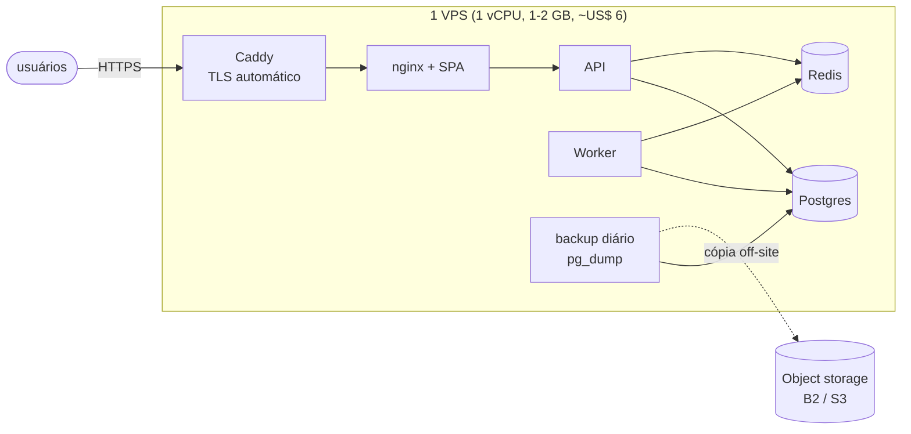

# Estágio 0 — 1 a 10 usuários ativos por dia

> **Objetivo:** colocar o sistema no ar de forma segura, barata e **recuperável**. Nessa escala,
> desempenho não é problema. O risco real é perder dados ou deixar a porta aberta.

## Perfil de carga

| Métrica | Valor | Conta |
|---|---|---|
| Requisições/dia | ~300 | 10 × 30 |
| RPS de pico | ~0,03 | uma requisição a cada 30 s |
| Pedidos/dia | ~3 | 10 × 0,3 |
| Dados/ano | ~2 MB | 3 × 365 × 2 KB |

Um Raspberry Pi aguentaria. O que define a arquitetura aqui é **custo** e **simplicidade de
operação**, não capacidade.

## Arquitetura



Tudo num servidor, com o mesmo `docker-compose.yml` do desenvolvimento e o overlay
`infra/single-node/docker-compose.prod.yml`.

## O que pode dar errado nesse estágio

| Risco | Probabilidade | Impacto | Mitigação |
|---|---|---|---|
| Disco do VPS corrompe / provedor perde a máquina | baixa | **total** (sem backup) | backup diário **fora** do servidor + restore testado |
| Segredo fraco ou padrão em produção | média | alto | a API **recusa subir** com `SECRET_KEY` padrão quando `ENV=production` |
| Banco/Redis expostos na internet | média | alto | o overlay de produção não publica portas; só o Caddy escuta 80/443 |
| Certificado TLS expirar | média | site fora | Caddy renova sozinho |
| Deploy quebra e não há volta | média | médio | tag da imagem anterior; `docker compose up -d` com a versão antiga |

## Mudanças em relação ao desenvolvimento

1. `ENV=production`: cookies `Secure`, Swagger desligado, validação de segredos no boot.
2. Nenhuma porta de dados publicada (`ports: !reset []`).
3. TLS na borda com Caddy (Let's Encrypt, HTTP/2 e HTTP/3, redirect 308 de HTTP para HTTPS).
4. **Backup diário + retenção de 7 dias + restore testado.**
5. Seed de demonstração desligado (`profiles: ["demo"]`).

## Passo a passo

```bash
# 1. Servidor: qualquer VPS Linux com Docker (Hetzner CX22, DigitalOcean Basic, Lightsail...)
ssh root@SEU_IP
curl -fsSL https://get.docker.com | sh
ufw allow OpenSSH && ufw allow 80 && ufw allow 443 && ufw enable

# 2. DNS: registro A de lux.seudominio.com.br -> SEU_IP

# 3. Código e segredos
git clone <repo> lux && cd lux
cp infra/single-node/.env.prod.example infra/single-node/.env.prod
python3 -c "import secrets; print(secrets.token_urlsafe(48))"   # um para cada segredo
nano infra/single-node/.env.prod

# 4. Subir
P="--env-file infra/single-node/.env.prod -f docker-compose.yml -f infra/single-node/docker-compose.prod.yml"
docker compose $P up -d --build

# 5. Primeiro admin (depois apague BOOTSTRAP_ADMIN_TOKEN do .env.prod e reinicie a API)
curl -X POST https://lux.seudominio.com.br/api/v1/auth/bootstrap-admin \
  -H "X-Bootstrap-Token: <token>" -H "Content-Type: application/json" \
  -d '{"full_name":"Admin","email":"voce@dominio.com","password":"<senha forte>"}'

# 6. Backup off-site (exemplo com rclone para Backblaze B2, ~US$ 0,01/mês nesse volume)
docker compose $P exec backup sh -c "apk add rclone && rclone copy /backups b2:lux-backups"

# 7. Restore drill: obrigatório, pelo menos uma vez
docker compose $P exec backup sh /restore.sh /backups/<arquivo>.dump
```

Esse fluxo foi executado localmente (`DOMAIN=localhost`) para validar este tutorial. O próprio
*restore drill* revelou um bug: o primeiro backup rodava antes das migrations e saía vazio. O
serviço de backup agora depende de `migrate` ter terminado.

## RPO e RTO desse estágio

- **RPO** (quanto dado se pode perder): até 24 h (backup diário). Para reduzir sem mudar de
  arquitetura, aumente a frequência do `pg_dump` ou use arquivamento de WAL (estágio 2).
- **RTO** (quanto tempo para voltar): ~30 min. Criar um VPS novo, `git clone`, `restore.sh`.

## Custo

| Item | US$/mês |
|---|---|
| VPS 1–2 vCPU, 2 GB | 5–8 |
| Domínio | ~1 |
| Backup off-site | < 1 |
| **Total** | **~US$ 6–10** |

## Sinais para ir ao estágio 1

- Mais gente além de você depende do sistema (você quer saber que caiu **antes** do cliente avisar).
- Deploys frequentes começam a dar medo (falta CI/CD e rollback rápido).
