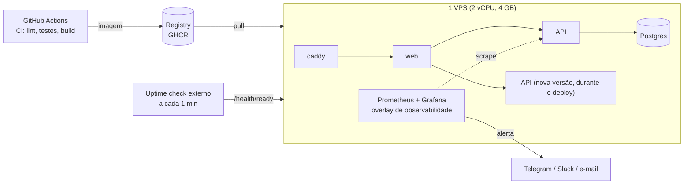

# Estágio 1 — 10 a 100 usuários ativos por dia

> **Objetivo:** o sistema virou um produto que outras pessoas usam. Agora você precisa **saber que
> caiu antes do cliente** e **colocar código novo no ar sem derrubar ninguém**. Ainda é um servidor só.

## Perfil de carga

| Métrica | Valor |
|---|---|
| RPS de pico | ~0,3 |
| Pedidos/dia | ~30 |
| SSE simultâneos no pico | ~10 |
| Dados/ano | ~22 MB |

A mesma máquina do estágio 0 sobra. O que muda é **processo**, não infraestrutura.

## Arquitetura



## O que quebra primeiro nesse estágio

| Problema | Como aparece | Solução deste estágio |
|---|---|---|
| Você não sabe que o sistema caiu | cliente reclama no WhatsApp | uptime check externo + alertas |
| Deploy derruba quem está usando | 502 por 10–30 s a cada release | rolling deploy com healthcheck |
| "Funciona na minha máquina" | bug só em produção | CI com Postgres e Redis reais (mesmas versões) |
| Migration incompatível com a versão no ar | erro 500 durante o deploy | migrations *expand/contract* |
| Erro sem contexto | "deu erro" sem detalhes | `request_id` no erro + logs JSON |

## Mudanças

### 1. CI/CD
O pipeline (`.github/workflows/ci.yml`) já roda:
- **API:** ruff, 145 testes contra Postgres 17 e Redis 7 reais, cobertura ≥ 85%, e `alembic check`
  (falha se models e migrations divergirem).
- **Contrato:** regenera o `openapi.json` e os tipos TypeScript; falha se o front ficou desatualizado.
- **Web:** lint, typecheck, 55 testes, build.
- **Imagens:** valida os arquivos compose, builda e sobe a stack inteira num smoke test.

O passo de CD natural aqui: push na `main` → imagem publicada no GHCR com tag do commit → job de
deploy faz `ssh` no servidor e roda `scripts/deploy-zero-downtime.sh`.

### 2. Deploy sem downtime num único servidor
`scripts/deploy-zero-downtime.sh`:

1. builda a imagem nova;
2. roda as migrations (que **precisam ser compatíveis com a versão antiga**, ver abaixo);
3. sobe um container novo **ao lado** do antigo (`--scale api=2 --no-recreate`);
4. espera o healthcheck (`/health/ready` também confere a versão da migration);
5. `nginx -s reload` passa a balancear entre os dois;
6. para o antigo com `SIGTERM`: o uvicorn termina as requisições em andamento (`--timeout-graceful-shutdown 20`);
7. se o novo não ficar saudável em 2 minutos, ele é removido e o antigo continua servindo.

**Validado:** com tráfego contínuo durante todo o deploy, **56 de 56 requisições retornaram 200**.
No primeiro teste, as sondas passaram de 300 req/min e receberam `429` do rate limit de produção, o
que só mostrou que o limitador estava funcionando; nenhum 5xx apareceu em nenhuma das execuções.

### 3. Migrations *expand/contract*
Durante o deploy, a versão antiga e a nova rodam **ao mesmo tempo** contra o mesmo schema. Toda
migration precisa funcionar com as duas:

| Mudança desejada | Errado (quebra a versão antiga) | Certo (em releases separados) |
|---|---|---|
| Renomear coluna `notes` → `observations` | `ALTER TABLE RENAME COLUMN` | R1: adiciona `observations`, app escreve nas duas · R2: backfill, app lê da nova · R3: remove `notes` |
| Nova coluna obrigatória | `ADD COLUMN x NOT NULL` | R1: `ADD COLUMN x NULL` + default no app · R2: backfill · R3: `SET NOT NULL` |
| Remover coluna | `DROP COLUMN` no mesmo release que para de usar | R1: app para de usar · R2: `DROP COLUMN` |

### 4. Monitoramento mínimo viável
```bash
# Prometheus + Grafana + exporters, com dashboard e 9 alertas prontos
docker compose -f docker-compose.yml -f docker-compose.observability.yml up -d
```
- Uptime externo (UptimeRobot, Better Stack ou healthchecks.io) batendo em `https://dominio/health/ready`
  a cada minuto. Ele mede **de fora**, que é o que o usuário vê.
- Alertas que importam nesse estágio: `ApiInstanceDown`, `WorkerDown`, `HighErrorRate`. Mais alertas
  do que isso geram fadiga e passam a ser ignorados.
- Rastreamento de erros (Sentry ou GlitchTip) é opcional; o `request_id` nos logs já resolve boa parte.

### 5. Backups com restore testado
Mantido do estágio 0, com uma rotina: **todo mês** o `scripts/restore.sh` roda num banco
descartável e confere contagens.

## Custo

| Item | US$/mês |
|---|---|
| VPS 2 vCPU / 4 GB | 10–20 |
| Uptime check | 0 (plano grátis) |
| GitHub Actions + GHCR | 0 (repositório público) |
| **Total** | **~US$ 10–30** |

## Sinais para ir ao estágio 2

- O banco e a aplicação disputam CPU/RAM na mesma máquina (`pg_stat_activity` cheio enquanto a API usa 100%).
- Uma manutenção ou reinício do servidor derruba **tudo** (inclusive o banco) e isso passou a ser inaceitável.
- O backup diário (RPO de 24 h) ficou arriscado demais para o volume de pedidos.
