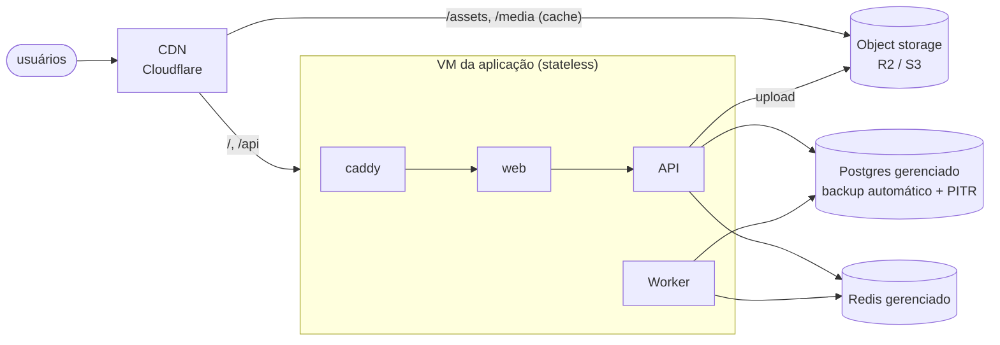

# Estágio 2 — 100 a 1.000 usuários ativos por dia

> **Objetivo:** separar o que tem **estado** (banco, Redis, arquivos) do que **não tem** (API, worker,
> web). Depois disso, perder uma VM da aplicação é um incômodo, não um desastre, e o caminho para
> escalar horizontalmente fica livre.

## Perfil de carga

| Métrica | Valor |
|---|---|
| RPS de pico | ~3 |
| Pedidos/dia | ~300 |
| SSE simultâneos no pico | ~90 |
| Dados/ano | ~220 MB |

Ainda é pouco: uma réplica da API medida aguenta ~250 RPS com p95 < 300 ms ([09](../09-testes-de-carga.md)).
A motivação desse estágio é **disponibilidade e durabilidade**, não desempenho.

## Arquitetura



## O que quebra primeiro nesse estágio

| Problema | Por quê | Solução |
|---|---|---|
| Reiniciar a VM derruba o banco junto | app e dados no mesmo host | Postgres e Redis gerenciados (outro host, outro ciclo de vida) |
| RPO de 24 h (backup diário) | `pg_dump` uma vez por dia | **PITR**: arquivamento contínuo de WAL, RPO de minutos |
| Imagens dentro do container/VM | o upload vai para o disco local | object storage (`STORAGE_BACKEND=s3`) |
| Fotos e JS servidos pela VM | cada visita baixa centenas de KB da sua máquina | CDN na frente de `/assets` e `/media` |
| Segredos em `.env` no servidor | qualquer pessoa com SSH lê tudo | secret manager do provedor / variáveis do PaaS |

## Mudanças

### 1. Postgres gerenciado com PITR
Opções: AWS RDS, Google Cloud SQL, Azure Flexible Server, Neon, Supabase, Crunchy Bridge. O que
você compra:

- **Backup contínuo + PITR**: restaurar "para 14:32 de ontem", antes do `DELETE` errado.
- **Failover**: réplica síncrona em outra zona (no plano HA). RTO de minutos.
- **Patches e upgrades de versão** sem você acordar às 3 h.

A aplicação muda só a `DATABASE_URL`. A conexão deve ser com TLS (`?ssl=require` no asyncpg) e o
usuário da aplicação **não deve ser superusuário** (superusuário ignora permissões e políticas de
RLS; vale a aplicação recusar subir se detectar isso).

### 2. Redis gerenciado
Upstash, ElastiCache, Memorystore. Uma decisão importante: o Redis aqui guarda dados **efêmeros**
(cache, rate limit, status de usuário) e o **stream de eventos**. Perder o stream é aceitável porque o
outbox no Postgres é a cópia durável (eventos não publicados continuam lá). Política de memória:
`volatile-lru`, para que só chaves com TTL sejam despejadas, nunca o stream.

### 3. Imagens em object storage + CDN
O adaptador já existe (`app/modules/catalog/storage.py`, porta `Storage` com `LocalStorage` e
`S3Storage`). Para trocar, basta configuração:

```bash
STORAGE_BACKEND=s3
S3_BUCKET=lux-media
S3_ENDPOINT_URL=https://<conta>.r2.cloudflarestorage.com   # R2: sem custo de egress
S3_ACCESS_KEY_ID=...
S3_SECRET_ACCESS_KEY=...
S3_PUBLIC_BASE_URL=https://cdn.seudominio.com.br
```

As chaves são **imutáveis** (`products/{id}/{timestamp}-{uuid}.webp`) e enviadas com
`Cache-Control: public, max-age=31536000, immutable`. Trocar a foto gera uma URL nova, então a CDN
nunca serve versão velha e nunca é preciso invalidar cache.

**Teste local** (validado com SeaweedFS, já que as imagens oficiais do MinIO deixaram de ser distribuídas):

```bash
docker compose -f docker-compose.yml -f docker-compose.s3.yml up -d
# upload pelo admin -> image_url = http://localhost:8333/lux-media/products/1/2026...webp
# GET nessa URL -> 200 image/webp, 1200x686 (redimensionada e convertida pela API)
```

### 4. CDN na frente de tudo
Cloudflare (plano grátis) na frente do domínio:
- `/assets/*` (JS/CSS com hash no nome): cache de 1 ano, já enviado pelo nginx como `immutable`.
- `/media/*` ou o domínio das imagens: cache longo.
- `/api/*`: **por padrão não cacheia**. O catálogo já manda `Cache-Control: public, max-age=30,
  stale-while-revalidate=120`, e no estágio 3 isso é ligado na CDN.

### 5. Duas VMs de aplicação? Ainda não precisa
Com dados fora da VM, uma VM de aplicação que morre é recriada em minutos (imagem Docker + variáveis).
Ter duas atrás de um load balancer dobra o custo para ganhar minutos de RTO. Isso entra no estágio 3,
quando o tráfego também pedir. Um PaaS (Fly.io, Render, Railway, Cloud Run) é uma alternativa válida
aqui: ele cuida do "recriar em minutos" por você.

## Custo

| Item | US$/mês |
|---|---|
| VM da aplicação (2 vCPU / 4 GB) | 15–30 |
| Postgres gerenciado pequeno (2 vCPU, PITR) | 25–60 (HA dobra) |
| Redis gerenciado pequeno | 0–15 |
| Object storage + CDN | 0–5 |
| **Total** | **~US$ 50–150** |

## Sinais para ir ao estágio 3

- CPU da API acima de ~60% no pico, ou p95 subindo nos horários de almoço e jantar.
- Você não pode mais tolerar a janela de "recriar a VM" quando ela falhar.
- O pool de conexões do Postgres gerenciado começa a ser o limite (planos pequenos permitem poucas conexões).
