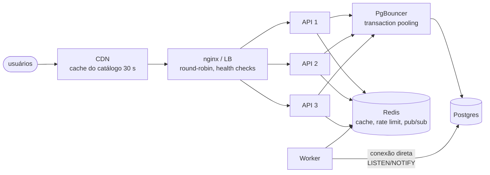

# Estágio 3 — 1.000 a 10.000 usuários ativos por dia

> **Objetivo:** escalar horizontalmente. A API é stateless, então capacidade vira um número de réplicas
> atrás de um load balancer. Os gargalos passam a ser os recursos **compartilhados**: conexões do
> Postgres, a vazão do Redis e a borda.

## Perfil de carga

| Métrica | Valor |
|---|---|
| RPS de pico | ~33 (rajadas de 2–3× em promoções) |
| Pedidos/s de pico | ~0,3 |
| SSE simultâneos no pico | ~900 |
| Dados/ano | ~2,2 GB |

Uma réplica dá conta da média, mas **não** de uma promoção no Instagram que multiplica o tráfego por
10 em 5 minutos, nem da perda dessa única réplica. São duas razões para N ≥ 2: **capacidade** e
**redundância** (N+1).

## Arquitetura (exatamente o que `docker-compose.scale.yml` sobe)



## O que quebra primeiro nesse estágio

### 1. Conexões do Postgres (antes da CPU)
Cada réplica abre um pool: `DB_POOL_SIZE + DB_MAX_OVERFLOW = 20` conexões. Com 10 réplicas, 2
workers e scripts de admin, são mais de 220 conexões. Cada conexão no Postgres é um **processo**
(~5–10 MB de RAM), e planos gerenciados pequenos permitem 100–200. O banco recusa conexões muito
antes de a CPU dele se esforçar.

**PgBouncer em *transaction pooling*:** a aplicação acha que tem 20 conexões por réplica; o PgBouncer
empresta uma conexão real só durante cada **transação**. No teste de carga com 3 réplicas, o Postgres
viu **~24 conexões no total** ([09](../09-testes-de-carga.md#3-escala-horizontal-1-réplica-vs-3-réplicas--pgbouncer)).

O que *transaction pooling* quebra, e como este código já evita:

| Recurso de sessão | Problema com transaction pooling | Neste projeto |
|---|---|---|
| Prepared statements nomeados | o próximo `EXECUTE` cai em outra conexão do servidor | `DB_BEHIND_PGBOUNCER=true` desliga o cache de statements do asyncpg e gera nomes únicos |
| `LISTEN/NOTIFY` | a conexão some depois da transação | o **worker** conecta direto no Postgres (o `NOTIFY` dentro da transação da API funciona normalmente) |
| `SET` de sessão | vaza para outros clientes | só `SET LOCAL` (escopo de transação), por exemplo no analytics |
| Advisory lock de sessão | fica preso numa conexão emprestada | só `pg_advisory_xact_lock` (liberado no commit) |
| `statement_timeout` como parâmetro de conexão | o PgBouncer não repassa parâmetros de startup | default no **banco** (`ALTER DATABASE … SET statement_timeout = '5s'`, em `infra/postgres/init`); migrations desligam explicitamente |

### 2. Estado em memória do processo
Qualquer coisa guardada em memória da API para de funcionar com N réplicas: sessão em memória, rate
limit local, cache local, lista de conexões WebSocket "minhas". Aqui:

| Estado | Onde fica | Funciona com N réplicas? |
|---|---|---|
| Sessão | cookie com JWT + `refresh_tokens` no Postgres | ✅ |
| Rate limit | sorted sets no Redis (Lua atômico) | ✅ limite global, não por réplica |
| Cache | Redis, com versão do namespace | ✅ invalidar em uma réplica vale para todas |
| Status do usuário (ativo/papel) | Redis | ✅ desativar tem efeito imediato em todas |
| Conexões SSE | memória de cada réplica, alimentadas pelo **hub** (1 assinatura Redis por processo) | ✅ sem sticky session |
| Imagens | object storage (estágio 2) | ✅ |

### 3. Tempo real com várias réplicas
O usuário 7 está conectado via SSE na réplica 2; o evento do pedido dele é processado pelo worker.
Como o worker entrega para a réplica certa? **Não entrega**: ele publica em `lux:rt:user:7` no Redis,
e cada réplica tem uma assinatura `PSUBSCRIBE lux:rt:*` que distribui a mensagem para as conexões
locais daquele usuário. Nenhuma réplica precisa saber onde os outros estão conectados, e o número de
conexões com o Redis cresce com o número de réplicas, não de usuários. ~900 conexões SSE nesse estágio
custam ~10–20 MB de RAM no total.

### 4. A borda vira o lugar mais barato para escalar leitura
O catálogo é **o mesmo para todo mundo** e muda pouco. A API já envia
`Cache-Control: public, max-age=30, stale-while-revalidate=120` em `GET /products` e `GET /categories`.
Ligando cache na CDN para esses caminhos, 90%+ das leituras do cardápio nem chegam ao load balancer.
O teste de carga mostra que a leitura do catálogo é o que satura a API primeiro
([09 §4](../09-testes-de-carga.md#4-traduzindo-para-usuários)), então esse é o investimento de maior
retorno do estágio.

```text
# Cloudflare: Cache Rule
Se  (http.request.uri.path in {"/api/v1/products" "/api/v1/categories"} and http.request.method eq "GET")
Então: Eligible for cache, Edge TTL = respeitar origem (30 s), cache key inclui query string
```

O admin vê alterações com até 30 s de atraso na vitrine pública. É um trade-off explícito, e as telas
de admin consultam `/products/admin`, que nunca é cacheado.

## Passo a passo (local, com números reais)

```bash
# 1. Sobe 3 réplicas + PgBouncer; nginx balanceia (rate limit desligado só para o teste de carga)
docker compose -f docker-compose.yml -f docker-compose.scale.yml -f docker-compose.loadtest.yml up -d --build
docker compose -f docker-compose.yml -f docker-compose.scale.yml up -d --force-recreate --no-deps web  # nginx resolve os 3 IPs

# 2. Observabilidade (o Prometheus descobre as réplicas por DNS)
docker compose -f docker-compose.yml -f docker-compose.scale.yml -f docker-compose.observability.yml up -d
# Grafana: http://localhost:3001

# 3. Carga
docker compose -f docker-compose.yml -f docker-compose.scale.yml -f docker-compose.loadtest.yml \
  run --rm -e PEAK_RPS=500 k6 run /scripts/browse.js
```

| Medição | 1 réplica | 3 réplicas + PgBouncer |
|---|---|---|
| Leitura a 500 RPS | p95 350 ms, 5,3% de 503 | **p95 7 ms, 0% de erro** |
| Escrita a 40 pedidos/s | p95 5,2 s, 9,8% de erro | **p95 161 ms, 0% de erro** |

### Zero downtime com N réplicas
Com o load balancer checando `/health/ready`, deploy é *rolling*: sobe uma réplica nova, ela passa no
readiness, entra no pool, uma antiga sai com `SIGTERM` e drena as requisições em andamento. A API já
separa **liveness** (`/health/live`: o processo está vivo) de **readiness** (`/health/ready`:
banco, Redis e versão da migration ok). Banco fora do ar deixa as réplicas *not ready* (o LB para de
mandar tráfego) sem que o orquestrador as reinicie em loop.

## Operação nesse estágio

- **SLOs com alertas** (`infra/prometheus/alerts.yml`): taxa de 5xx > 1%, p95 > 500 ms, backlog no outbox, worker fora.
- **Load test como gate de release** para mudanças em caminhos quentes: os thresholds do k6
  (`http_req_duration p(95)<250`) falham o pipeline.
- **Runbooks** ([10](../10-observabilidade-e-runbooks.md)) para os alertas que acordam alguém.
- **WAF/rate limit na borda** (Cloudflare) contra abuso volumétrico. O rate limit da aplicação continua
  existindo para regras de negócio (login por conta).

## Custo

| Item | US$/mês |
|---|---|
| 2–3 VMs/containers de aplicação | 60–150 |
| Postgres gerenciado com HA | 100–250 |
| Redis gerenciado | 15–50 |
| PgBouncer (sidecar ou pequeno) | 0–15 |
| CDN, object storage, monitoramento | 20–100 |
| **Total** | **~US$ 200–600** |

## Sinais para ir ao estágio 4

- Escalar réplicas virou tarefa manual frequente (o tráfego varia muito entre almoço, jantar e madrugada).
- As consultas de relatório (analytics) disputam o mesmo Postgres que os pedidos.
- Uma zona de disponibilidade inteira fora do ar derrubaria o sistema.
- O worker único começa a acumular backlog (`lux_outbox_pending` subindo nos picos).
