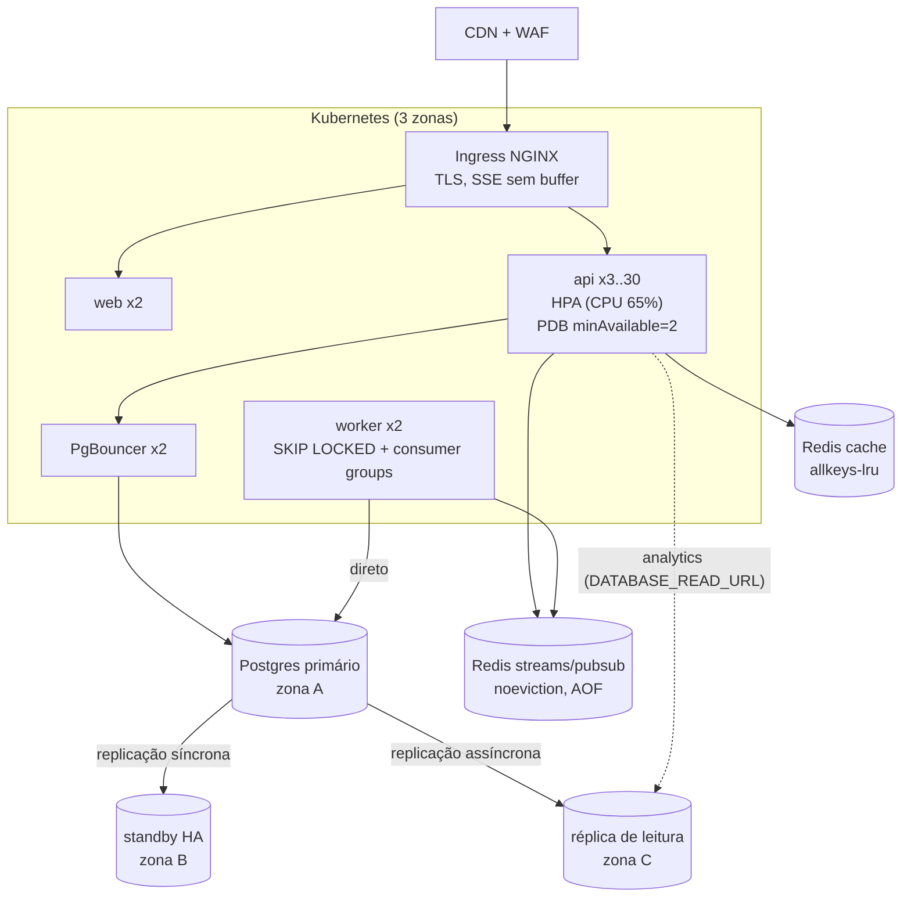

# Estágio 4 — 10.000 a 100.000 usuários ativos por dia

> **Objetivo:** a capacidade passa a se ajustar sozinha ao tráfego (autoscaling), o sistema sobrevive
> à perda de uma zona de disponibilidade inteira, e leituras pesadas param de competir com pedidos.
> É aqui que Kubernetes começa a se pagar.

## Perfil de carga

| Métrica | Valor |
|---|---|
| RPS de pico | ~330 (rajadas de ~1.000) |
| Pedidos/s de pico | ~3,3 |
| Escritas/s de pico | ~50 |
| SSE simultâneos no pico | ~9.000 |
| Dados/ano | ~22 GB |

Pela medição ([09](../09-testes-de-carga.md)), ~250 RPS por réplica com p95 confortável: o pico pede
**2–4 réplicas** e as rajadas, **5–8**. O tráfego da madrugada é ~5% do pico, e manter 8 réplicas 24 h
por dia é desperdício. Daí o autoscaling.

## Arquitetura



Manifests prontos em `infra/k8s/` (kustomize): Deployments, Service, HPA, PDB, Ingress, Job de migration.
O CI renderiza com `kustomize` e valida os 12 recursos contra o schema oficial do Kubernetes (`kubeconform -strict`).

## O que quebra primeiro nesse estágio

| Problema | Sintoma | Solução |
|---|---|---|
| Capacidade fixa vs tráfego variável | p95 explode no almoço, VMs ociosas de madrugada | **HPA** por CPU (alvo 65%) |
| Deploy derruba capacidade no pico | menos réplicas atendendo durante o rollout | `maxUnavailable: 0`, `maxSurge: 1`, **PDB** |
| Zona de disponibilidade cai | sistema inteiro fora | réplicas espalhadas por zona (`topologySpreadConstraints`), banco com standby em outra zona |
| Analytics disputa CPU/IO com pedidos | `GET /analytics/orders` lento → p95 de pedidos sobe | **réplica de leitura** para analytics |
| Um Redis para tudo | uma rajada de cache despeja chaves; stream de eventos em risco | **dois Redis**: cache (`allkeys-lru`) e streams/pubsub (`noeviction` + AOF) |
| Worker único | backlog no outbox no pico (medido: worker a ~93% com 80 pedidos/s) | **N réplicas do worker** (o código já é seguro para isso) |
| Migration trava tabela grande | `ALTER TABLE` com lock por minutos | migrations **online** (abaixo) |

## Mudanças

### 1. Kubernetes com autoscaling (`infra/k8s/api.yaml`)

```yaml
resources:
  requests: {cpu: 250m, memory: 256Mi}
  limits:   {memory: 512Mi}        # sem limite de CPU: evita throttling do CFS em serviços sensíveis a latência
readinessProbe: {httpGet: {path: /health/ready}}   # tira do balanceamento
livenessProbe:  {httpGet: {path: /health/live}}    # reinicia só se o processo travou
lifecycle: {preStop: {exec: {command: ["sleep", "5"]}}}  # o LB tira o pod antes do SIGTERM
---
kind: HorizontalPodAutoscaler   # min 3, max 30, CPU 65%, scale-down estabilizado em 5 min
kind: PodDisruptionBudget       # minAvailable: 2 durante manutenção de nós
```

**Por que CPU 65% e não 90%?** O teste de carga mostrou o p95 saindo de 5 ms para 350 ms entre ~60% e
~100% de uso de uma réplica. É o comportamento clássico de fila (latência ∝ 1/(1−utilização)). Além
disso, o HPA leva ~1 minuto para colocar pods novos no ar, e a folga de 35% absorve a rajada enquanto
eles sobem.

**Por que 1 processo por pod e não `--workers 4`?** As métricas Prometheus continuam simples (sem modo
multiprocess), o escalonador do k8s enxerga a carga real, e um pod que morre leva menos capacidade junto.

### 2. Réplica de leitura para analytics (implementado)

```python
# app/core/database.py
read_engine = create_async_engine(settings.DATABASE_READ_URL, ...) if settings.DATABASE_READ_URL else engine

# app/modules/analytics/router.py
session: AsyncSession = Depends(get_read_session)   # relatórios toleram segundos de atraso
```

Regra de ouro: **nunca** leia da réplica num fluxo *read-your-writes* (criar o pedido e logo em
seguida mostrá-lo). A réplica assíncrona pode estar centenas de milissegundos atrás. Analytics,
dashboards e exportações são os candidatos perfeitos. Monitore o atraso
(`pg_last_xact_replay_timestamp()` na réplica) e tire a réplica de serviço se passar de alguns segundos.

### 3. Dois Redis com papéis diferentes

| Instância | Conteúdo | Política | Persistência |
|---|---|---|---|
| `redis-cache` | cache do catálogo/analytics, status de usuário, rate limit | `allkeys-lru` (despejar é ok) | nenhuma |
| `redis-events` | `lux:events` (Streams), DLQ, Pub/Sub de tempo real | `noeviction` (nunca perder eventos silenciosamente) | AOF `everysec` |

Hoje um só Redis faz os dois papéis com `volatile-lru` (só chaves com TTL são despejadas). Separar é
mudar duas URLs (`REDIS_URL` para cache, uma nova `EVENTS_REDIS_URL` para streams), uma refatoração
pequena porque `core/realtime.py` e `workers/consumer.py` já usam conexões dedicadas.

### 4. Workers escalando horizontalmente
O desenho já suporta N réplicas sem coordenação extra:

- **relay do outbox:** `FOR UPDATE SKIP LOCKED`, então cada réplica pega lotes diferentes;
- **consumers:** consumer groups do Redis Streams entregam cada mensagem a um consumidor do grupo, e
  `XAUTOCLAIM` resgata mensagens de um pod que morreu;
- **manutenção:** `pg_try_advisory_xact_lock`, então só uma réplica executa a limpeza em cada ciclo.

Escalar por **backlog** é melhor do que por CPU: um HPA com métrica externa (KEDA lendo `lux_outbox_pending`
ou o *pending* do consumer group) reage ao que realmente importa, que é o atraso dos eventos.

### 5. Migrations sem downtime
Com tabelas de dezenas de GB, alguns comandos travam escrita por minutos:

| Operação | Comando perigoso | Alternativa online |
|---|---|---|
| Criar índice | `CREATE INDEX` (bloqueia escritas) | `CREATE INDEX CONCURRENTLY` (no Alembic: `postgresql_concurrently=True`, fora de transação) |
| Adicionar FK/CHECK | `ADD CONSTRAINT` (varre a tabela com lock) | `ADD CONSTRAINT … NOT VALID` + `VALIDATE CONSTRAINT` (lock leve) |
| Coluna `NOT NULL` | `SET NOT NULL` (varredura com lock) | `CHECK (col IS NOT NULL) NOT VALID` → `VALIDATE` → `SET NOT NULL` (o PG usa o check validado) |
| Trocar tipo (`INT` → `BIGINT`) | `ALTER COLUMN TYPE` (reescreve a tabela) | coluna nova + trigger de sincronização + backfill em lotes + troca de nomes |
| Qualquer DDL | lock que espera e bloqueia a fila atrás dele | `SET lock_timeout = '3s'` + retry |

A migration `v3_schema_hardening` deste repo usa os comandos simples porque roda num banco pequeno. A
tabela acima é o que mudaria se ela rodasse em produção com 100 GB.

### 6. Observabilidade: de métricas para rastreamento
Com 10+ pods, "qual réplica respondeu devagar e por quê" exige **tracing distribuído**. O próximo
passo natural é OpenTelemetry (FastAPI, SQLAlchemy, Redis instrumentados) exportando para Tempo ou
Jaeger, com o `request_id` atual propagado como atributo. A instrumentação pode ficar opcional (um
`requirements-otel.txt` separado e uma variável para ligar). Alertas passam a ser por **burn rate de SLO** (quão
rápido o orçamento de erro está sendo gasto), e não por limiar fixo.

### 7. Entrega progressiva
- **Canary:** 5% do tráfego para a versão nova por 10 minutos, comparando taxa de erro e p95 antes de
  promover (Argo Rollouts ou Flagger).
- **Feature flags** para mudanças de comportamento: o deploy deixa de ser o momento do risco.

## Custo

| Item | US$/mês |
|---|---|
| Kubernetes gerenciado (EKS/GKE/AKS) + nós (autoscaling) | 500–1.500 |
| Postgres com HA + 1 réplica de leitura | 600–1.500 |
| 2 Redis gerenciados | 150–400 |
| CDN/WAF, observabilidade, logs | 300–1.500 |
| **Total** | **~US$ 2–6 mil** |

## Sinais para ir ao estágio 5

- `orders`/`order_tracking_events` passam de dezenas de milhões de linhas; o `VACUUM` demora e índices incham.
- Analytics na réplica fica lento mesmo assim (agregações sobre meses de dados).
- O número de conexões SSE simultâneas (dezenas de milhares) passa a pesar na memória das réplicas da API.
- O primário começa a ficar sem folga de escrita nos picos.
