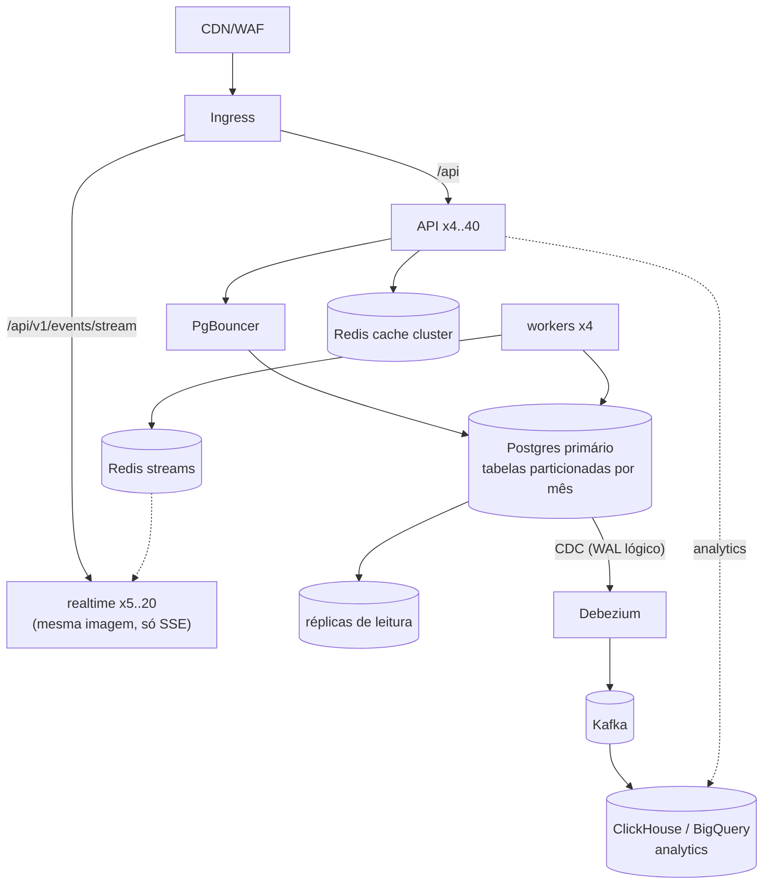

# Estágio 5 — 100.000 a 1.000.000 usuários ativos por dia

> **Objetivo:** o volume de **dados** passa a ditar a arquitetura. Tabelas com centenas de milhões de
> linhas, relatórios sobre meses de histórico e ~90 mil conexões de tempo real simultâneas. As
> estratégias agora são **particionar por tempo**, **separar OLTP de OLAP** (CQRS para leitura
> analítica) e **isolar o tempo real** num serviço próprio.

## Perfil de carga

| Métrica | Valor |
|---|---|
| RPS de pico | ~3.300 (rajadas de ~10 mil) |
| Pedidos/dia | ~300 mil |
| Pedidos/s de pico | ~33 |
| Escritas/s de pico | ~500 |
| SSE simultâneos no pico | **~90 mil** |
| Dados/ano | ~220 GB (`order_tracking_events` ~5× maior que `orders`) |

Com cache na CDN segurando ~90% do catálogo, a origem recebe ~500–800 RPS: 4–8 réplicas a 65% de CPU.
Escrita (~500 linhas/s) cabe com folga num primário Postgres de 8–16 vCPU. **Nem CPU nem escrita são o
problema central aqui. Dados e conexões são.**

## Arquitetura



## O que quebra primeiro nesse estágio

### 1. Tabelas gigantes, manutenção lenta
Com ~1,5 bi de linhas em `order_tracking_events` em um ano:

- `VACUUM` e `ANALYZE` passam a levar horas; o *bloat* cresce mais rápido que o autovacuum limpa;
- apagar dados antigos com `DELETE … WHERE created_at < …` gera bloat e WAL gigantes;
- índices não cabem mais na RAM, e o *buffer hit ratio* (no dashboard) cai abaixo de 99%;
- backup e restore de uma tabela de 500 GB levam horas, e o RTO sobe junto.

**Solução: particionamento declarativo por mês** em `orders`, `order_items`, `order_tracking_events`
e `notifications`:

```sql
-- PK precisa incluir a chave de partição
CREATE TABLE orders_new (LIKE orders INCLUDING DEFAULTS INCLUDING CONSTRAINTS,
                         PRIMARY KEY (id, created_at))
  PARTITION BY RANGE (created_at);

CREATE TABLE orders_2026_10 PARTITION OF orders_new FOR VALUES FROM ('2026-10-01') TO ('2026-11-01');
-- partições futuras criadas por pg_partman (premake = 3 meses)

-- Apagar 2023 inteiro vira O(1), sem bloat:
ALTER TABLE orders_new DETACH PARTITION orders_2023_01 CONCURRENTLY;  -- e arquivar em object storage
```

O que se ganha:

| Ganho | Por quê |
|---|---|
| Queries por período leem só as partições do intervalo | *partition pruning* (analytics de 30 dias toca 1–2 partições) |
| Índices menores por partição | o índice do mês corrente cabe em RAM |
| Retenção O(1) | `DETACH` + `DROP` em vez de `DELETE` em massa |
| `VACUUM` por partição | meses antigos ficam congelados e quase não precisam de vacuum |

**Custo/armadilhas:** a unicidade global de `id` deixa de ser garantida pela PK sozinha (a sequence
garante na prática); FKs **para** tabelas particionadas exigem incluir `created_at`; queries sem filtro
de data varrem todas as partições. A migração de uma tabela viva para particionada segue o padrão
*expand/contract*: tabela nova, escrita dupla via trigger, backfill em lotes, troca de nomes.

### 2. Analytics sobre meses de histórico
Hoje o analytics agrega direto em `orders` (`percentile_cont`, `generate_series`). Com 300 mil pedidos
por dia, um relatório de 90 dias agrega ~27 M de linhas: segundos mesmo na réplica, e cada filtro novo
pedido pelo negócio vira uma query ad hoc no OLTP.

**Solução em duas etapas:**

1. **Rollups incrementais** (barato, ainda no Postgres): o worker consome `order.status_changed` e
   mantém uma tabela `order_daily_stats (day, status, orders, revenue, sum_minutes, histogram)`. O
   dashboard lê 90 linhas em vez de 27 milhões. Percentis exatos viram aproximados (histograma ou
   *t-digest*), um trade-off aceitável para dashboards.
2. **CQRS / OLAP** (quando o negócio pedir análises livres): **CDC** com Debezium lendo o WAL lógico do
   Postgres → Kafka → ClickHouse ou BigQuery. O OLTP não recebe nenhuma query analítica; o time de
   dados consulta à vontade sem risco para os pedidos. Consistência eventual de segundos.

### 3. 90 mil conexões SSE
Conexão ociosa custa pouca CPU, mas custa **memória** (~10–20 KB cada em asyncio, mais buffers do
kernel) e **file descriptors**. Pior: conexões longas distorcem o autoscaling da API, porque um pod com
20 mil conexões ociosas está "cheio" para o load balancer e "vazio" para o HPA de CPU.

**Solução: separar o tempo real num deployment próprio** (`lux-realtime`), com a **mesma imagem** e
só a rota `/events/stream`:

| | API | Realtime |
|---|---|---|
| Tráfego | requisições curtas | conexões longas |
| Métrica do HPA | CPU | número de conexões por pod (`lux_sse_connections`) |
| Pods | 4–40 | 5–20, com ~5–10 mil conexões cada |
| Tuning | padrão | `ulimit -n` alto, `net.core.somaxconn`, keepalive |
| Deploy | rolling rápido | rolling lento (reconectar 90 mil clientes de uma vez é um *thundering herd*) |

O hub com **uma assinatura Redis por processo** é o que torna isso viável: 20 pods = 20 conexões
Pub/Sub, e não 90 mil. O cliente já reconecta com *backoff* exponencial e *jitter*
(`apps/web/src/app/realtime.tsx`), o que espalha as reconexões depois de um deploy.

### 4. Cache em camadas
| Camada | O que guarda | TTL | Invalidação |
|---|---|---|---|
| Navegador | assets, imagens | 1 ano (`immutable`) | URL nova a cada deploy/upload |
| CDN | catálogo público | 30 s + `stale-while-revalidate` | expira sozinho |
| Memória do processo (novo) | categorias, config | 5–10 s | expira sozinho (aceita 10 s de atraso) |
| Redis | catálogo, analytics, status de usuário | 60–300 s | versão do namespace (`INCR`) |

A camada em memória do processo elimina até a ida ao Redis nas chaves mais quentes. Com 40 réplicas,
cada uma lendo `categories` 100 vezes por segundo, isso tira 4 mil comandos/s do Redis.

### 5. Primário Postgres: ainda um só
~500 escritas/s é confortável. O que se faz aqui é **reduzir trabalho por escrita**:

- `synchronous_commit = off` só para escritas não críticas (notificações, tracking), nunca para o
  pedido em si (perde até ~600 ms de dados num crash, mas não corrompe);
- `INSERT` de itens e eventos em lote (já é feito: um `INSERT` multi-linha por pedido);
- `fillfactor` menor em `orders` (updates de status viram HOT updates, sem tocar nos índices).

## Custo

| Item | US$/mês |
|---|---|
| Kubernetes (API, realtime, workers) | 3–8 mil |
| Postgres primário grande + HA + 2 réplicas | 4–10 mil |
| Kafka gerenciado + Debezium | 1,5–5 mil |
| ClickHouse/BigQuery | 1–5 mil |
| Redis cluster, CDN, observabilidade | 3–15 mil |
| **Total** | **~US$ 15–50 mil** |

## Sinais para ir ao estágio 6

- Escrita no primário perto do limite de um nó (CPU, WAL/s ou IOPS) e sem mais o que otimizar.
- Times diferentes mudando módulos diferentes atrapalham os deploys uns dos outros.
- Clientes em outras regiões/países (latência, LGPD/residência de dados).
- O produto vira **marketplace** com milhares de restaurantes: aparece uma chave natural de sharding.
