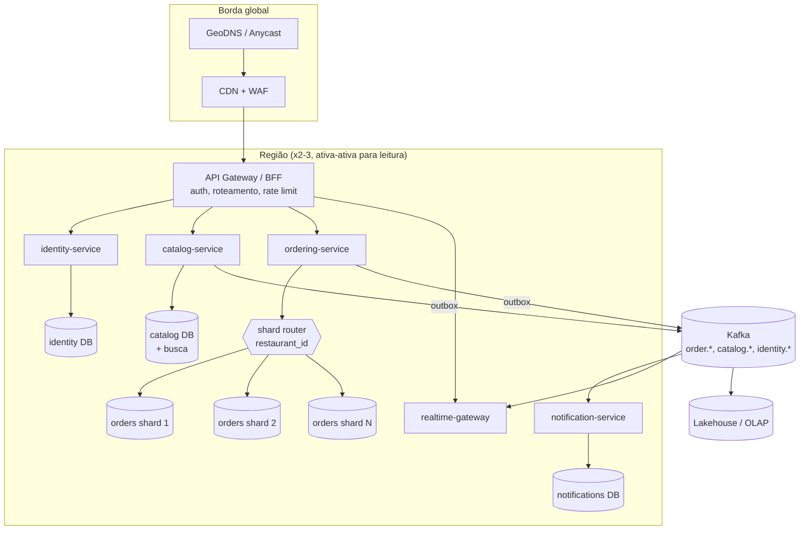

# Estágio 6 — 1 milhão a 10 milhões+ de usuários ativos por dia

> **Objetivo:** um único banco primário e um único deploy deixam de ser possíveis. Do lado técnico, a
> escrita passa do que um nó aguenta. Do lado organizacional, dezenas de engenheiros não conseguem
> trabalhar no mesmo deploy. As respostas são **federação** (um banco por domínio), **sharding**
> (dividir um domínio por chave), **serviços independentes** e **multi-região**.

## Perfil de carga

| Métrica | 1 M DAU | 10 M DAU |
|---|---|---|
| RPS de pico | ~3.300 | ~33.000 |
| Pedidos/s de pico | ~33 | ~330 |
| Escritas/s de pico | ~500 | ~5.000 |
| SSE simultâneos | ~90 mil | ~900 mil |
| Dados/ano | ~220 GB | ~2,2 TB |

Nesse volume, o Lux deixou de ser "o delivery de um restaurante" e virou uma **plataforma**
multi-tenant. A unidade natural de divisão passa a ser o
**restaurante (tenant)**.

## Arquitetura

## As quatro mudanças (detalhes em [08](../08-federacao-sharding-e-microservicos.md))

### 1. Federação: um banco por domínio
Os módulos do monólito viram donos dos seus bancos: `identity`, `catalog`, `ordering`,
`notifications`. Funciona porque **a fronteira já existe no código**: o `ordering` só lê o catálogo via
`catalog/public.py::get_orderable_products()`. Federar é trocar a implementação dessa função de SQL
local para uma chamada HTTP/gRPC (ou uma cópia local do catálogo alimentada por eventos). Cada banco
volta a ser "pequeno" e escala de forma independente.

**O que se perde:** `JOIN` entre domínios e transação atômica entre domínios. O que entra no lugar:
dados replicados por eventos (o pedido já guarda `product_name`/`unit_price` como snapshot, e não
precisa do catálogo depois de criado) e **sagas** para operações que cruzam domínios.

### 2. Sharding do domínio de pedidos por `restaurant_id`
Mesmo federado, o banco de pedidos com 10 M DAU recebe ~5 mil escritas/s e acumula terabytes. A chave
de shard é **`restaurant_id`**:

- quase toda query já é por restaurante (o quadro da cozinha, o analytics da loja);
- a transação de um pedido nunca cruza restaurantes;
- a distribuição é razoavelmente uniforme quando os restaurantes são muitos. Restaurantes gigantes
  (*hot tenants*) ganham shard dedicado no diretório.

Implementação recomendada: **Citus** (extensão do Postgres que distribui tabelas por coluna e
mantém SQL e transações por shard) ou sharding na aplicação com um **diretório** `restaurant_id →
shard` (permite mover um restaurante de shard sem *rehash* global).

"Meus pedidos" do **cliente** cruza restaurantes. A solução é uma **visão materializada por cliente**
(tabela `customer_orders` em outro store, alimentada por `order.*`), e não uma busca em todos os shards.

### 3. Serviços independentes (Strangler Fig)
Extração gradual, sem *big bang*:

1. o gateway passa a rotear `/api/v1/notifications/*` para o `notification-service` novo;
2. o serviço novo consome os mesmos eventos (`order.*`), já que o outbox e os consumer groups existem;
3. quando o tráfego estabiliza, o código antigo é removido do monólito.

Ordem sugerida pelo risco: **notifications** (só consome eventos) → **realtime-gateway** (stateless) →
**catalog** (muito lido, pouco escrito) → **ordering** (o coração, por último).

### 4. Multi-região
- **Leitura ativa-ativa:** catálogo replicado em todas as regiões (CDN + réplicas), latência local.
- **Escrita com *home region* por restaurante:** os pedidos de um restaurante são escritos na região
  dele. Evita conflitos de escrita multi-master, ao custo de alguns ms a mais para clientes de outra região.
- **Failover regional** testado (*game days*): RPO de segundos com replicação assíncrona cross-region,
  RTO de minutos com promoção automatizada.
- **Residência de dados** (LGPD): dados de clientes brasileiros ficam em `sa-east-1`; o shard
  directory também codifica a região.

## Kafka substitui o Redis Streams como barramento
| Gatilho | Redis Streams (até aqui) | Kafka (aqui) |
|---|---|---|
| Vazão | dezenas de milhares de msg/s | milhões de msg/s, particionado |
| Retenção | limitada pela RAM (`MAXLEN`) | dias ou semanas em disco, *replay* para novos consumidores |
| Ordenação | por stream | **por partição**: chave = `order_id` garante ordem por pedido |
| Consumidores | poucos grupos | dezenas de times consumindo de forma independente |

A troca é localizada: o relay do outbox passa a publicar no Kafka (Debezium pode até substituir o
relay, lendo a tabela `outbox_events` pelo WAL). Os consumers mantêm a mesma regra de idempotência por
`event_id`.

## Custo e pessoas

Ordem de **US$ 100 mil+/mês** em infraestrutura. O custo dominante, porém, passa a ser **pessoas**:
times de plataforma, SRE em plantão 24/7, engenharia de dados. Arquitetura nesse estágio é desenhada
tanto para a organização (Lei de Conway) quanto para a carga.

## O que este projeto deixa pronto para esse futuro

| Peça já existente | Papel no estágio 6 |
|---|---|
| Fronteiras de módulo + `public.py` | vira o contrato entre serviços |
| Outbox transacional + consumers idempotentes | vira a espinha dorsal de sagas e da federação |
| Snapshot de nome/preço no item | o pedido não depende do catálogo depois de criado |
| `BIGINT` + keyset pagination | IDs e paginação funcionam em shards |
| Idempotency-Key | retries entre serviços e regiões sem duplicar pedidos |
| Hub de tempo real desacoplado | vira o `realtime-gateway` |
