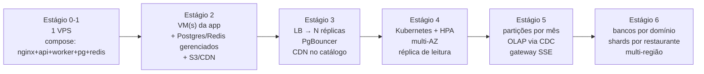

# 07 — Escalabilidade: de 1 a 10 milhões de usuários

> Um tutorial em estágios. Cada estágio tem o **perfil de carga** (com as contas), a **arquitetura**,
> **o que quebra primeiro**, as **mudanças** com justificativa, um **passo a passo** usando este
> repositório e o **sinal** para ir ao próximo estágio. "Usuários" significa **usuários ativos por
> dia (DAU)**; o modelo de carga está em [01 — Requisitos](../01-requisitos-e-capacidade.md#4-modelo-de-carga-back-of-the-envelope).

## O método (vale mais do que qualquer estágio)

1. **Meça antes de mudar.** SLO definido, dashboard, teste de carga. Sem número, não existe gargalo,
   só opinião. ([09](../09-testes-de-carga.md) mostra quatro gargalos que só apareceram medindo.)
2. **Ache o gargalo atual**: CPU da aplicação? conexões? I/O do banco? lock? rede? Use o *USE method*
   (Utilization, Saturation, Errors) para cada recurso.
3. **Faça a menor mudança que o remove** e meça de novo. O próximo gargalo aparece em outro lugar.
4. **Prefira, nesta ordem:** não fazer nada → otimizar o código/query → cache → escalar
   horizontalmente o que é stateless → mover trabalho para assíncrono → separar leitura de escrita →
   particionar dados → federar → shardear. Cada passo à direita custa mais em complexidade
   operacional que o anterior.

## Visão geral

| Estágio | DAU | RPS de pico | Pedidos/s de pico | Arquitetura | Mudança-chave | Custo/mês (ordem de grandeza) |
|---|---|---|---|---|---|---|
| [0](01-estagio-0-1-a-10-usuarios.md) | 1–10 | < 0,1 | ~0 | 1 VPS, `docker compose` | backup testado | US$ 5–10 |
| [1](02-estagio-1-10-a-100-usuarios.md) | 10–100 | < 1 | ~0 | 1 VPS + CI/CD + monitoramento | deploy sem downtime, alertas | US$ 10–30 |
| [2](03-estagio-2-100-a-1k-usuarios.md) | 100–1k | ~3 | ~0,03 | app separada dos dados gerenciados | Postgres/Redis gerenciados, S3 + CDN | US$ 50–150 |
| [3](04-estagio-3-1k-a-10k-usuarios.md) | 1k–10k | ~33 | ~0,3 | N réplicas + LB + PgBouncer | API stateless escalando horizontalmente | US$ 200–600 |
| [4](05-estagio-4-10k-a-100k-usuarios.md) | 10k–100k | ~330 | ~3 | Kubernetes, multi-AZ, réplica de leitura | autoscaling, read/write split, migrations online | US$ 2–6 mil |
| [5](06-estagio-5-100k-a-1m-usuarios.md) | 100k–1M | ~3.300 | ~33 | particionamento, OLAP separado, gateway de tempo real | dados por tempo, CQRS para analytics | US$ 15–50 mil |
| [6](07-estagio-6-1m-a-10m-usuarios.md) | 1M–10M+ | ~33.000 | ~330 | federação por domínio, sharding, multi-região | bancos por domínio, sagas, Kafka | US$ 100 mil+ |

Os custos são ordens de grandeza de nuvem pública em 2026, só para comparar estágios entre si. Não
são orçamento.

## Como a arquitetura evolui

## O que este repositório já resolve (e por que isso importa para escalar)

| Decisão já implementada | Estágio em que ela "paga" |
|---|---|
| API **stateless** (sessão em cookie/JWT, estado em Postgres/Redis) | 3: escalar = aumentar réplicas |
| Hub de tempo real com **1 assinatura Redis por processo** | 3–5: SSE com N réplicas, sem sticky session |
| **Outbox + worker** separado da API | 3–6: trabalho lento fora do caminho da requisição; vira o barramento de eventos da federação |
| **Idempotência** no pedido | 3+: retries do LB/cliente ficam seguros |
| **Cache versionado** + `Cache-Control` público | 3: CDN pode cachear o catálogo |
| **Keyset pagination** | 4–5: custo constante com milhões de linhas |
| **BIGINT** nas tabelas de volume | 5: sem migração dolorosa de tipo |
| **Módulos com fronteiras** (`catalog/public.py`) | 6: federação e extração de serviços |
| **Métricas + alertas + load shedding** | todos: saber *quando* mudar de estágio |
| **PgBouncer-ready** (`DB_BEHIND_PGBOUNCER`), worker com conexão direta | 3 |
| Manifests **k8s** com probes, HPA, PDB | 4 |

## Números de referência medidos neste repo

| Medida | Valor | Fonte |
|---|---|---|
| 1 réplica (1 processo), leitura com p95 < 300 ms | ~250 RPS | [09 §2](../09-testes-de-carga.md#2-a-jornada-cada-linha-é-uma-medição-real) |
| 1 réplica, escrita com p95 < 200 ms | ~25 pedidos/s | [09 §2](../09-testes-de-carga.md#escrita-checkoutjs-contra-1-réplica) |
| 3 réplicas + PgBouncer, leitura (mesma máquina do gerador) | ~600–700 RPS | [09 §3](../09-testes-de-carga.md#3-escala-horizontal-1-réplica-vs-3-réplicas--pgbouncer) |
| Primeiro recurso a saturar | CPU do processo Python | profile + `pg_stat_activity` |
| Segundo | worker (1 processo), Postgres, PgBouncer | [09 §3](../09-testes-de-carga.md#o-que-satura-depois-da-api-80-pedidoss-3-réplicas) |

## Perguntas que este capítulo responde

- "Seu sistema tem 10× mais usuários amanhã. O que quebra primeiro?" → estágio seguinte ao atual,
  seção *O que quebra primeiro*.
- "Por que não começar com microserviços/Kubernetes?" → estágios 0–3 (custo vs benefício).
- "Como você escala WebSocket/SSE?" → estágios 3 e 5.
- "Como você faz migration sem downtime?" → estágio 4.
- "Quando particionar? Quando shardear? Qual a chave?" → estágios 5 e 6 e o [capítulo 08](../08-federacao-sharding-e-microservicos.md).
