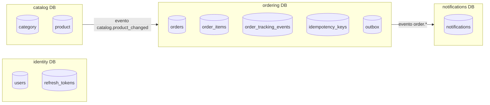
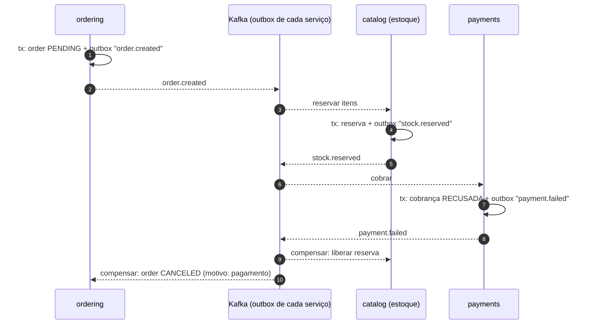

# 08 — Federação, sharding e microserviços

> Como dividir dados e serviços quando um banco e um deploy não bastam, aplicado ao domínio do Lux.
> A regra que guia o capítulo: **cada técnica resolve um problema específico e cria outros.** Só use
> quando o problema que ela resolve existir (os sinais estão no [tutorial de escala](07-escalabilidade/README.md)).

## 1. Vocabulário (termos que costumam ser confundidos)

| Técnica | O que divide | Resolve | Custa |
|---|---|---|---|
| **Replicação** | nada (copia o banco inteiro) | escalar **leitura**, alta disponibilidade | atraso de réplica, *read-your-writes* |
| **Particionamento** (no mesmo servidor) | uma tabela em pedaços por chave (ex.: mês) | manutenção e queries em tabelas enormes, retenção O(1) | PK precisa incluir a chave de partição |
| **Federação** (particionamento funcional) | o **banco** por **domínio** (identity, catalog, ordering…) | escrita e tamanho por domínio, autonomia de times | sem `JOIN`/transação entre domínios |
| **Sharding** (particionamento horizontal entre servidores) | as **linhas** de um domínio entre N bancos por chave | escrita e volume além de um nó | queries entre shards, rebalanceamento, IDs globais |
| **Desnormalização / CQRS** | a forma de leitura da forma de escrita | leituras caras ou entre domínios | consistência eventual, mais armazenamento |

Ordem natural de adoção: replicação → particionamento → federação → sharding. Cada uma pressupõe a
anterior bem resolvida.

## 2. Federação no Lux

### Domínios e donos



### O que hoje cruza fronteiras, e como fica federado

| Interação atual (mesmo banco) | Depois da federação |
|---|---|
| `ordering` lê preço/disponibilidade via `catalog/public.py` | **Opção A:** chamada síncrona `GET catalog/products?ids=` com timeout curto e circuit breaker. **Opção B (preferida):** `ordering` mantém uma **réplica local** de `(id, name, price, is_available)` alimentada por `catalog.product_changed`, e o checkout fica imune a falhas do catálogo. |
| FK `order_items.product_id → product.id` | deixa de existir; integridade garantida pelo **snapshot** no item e pela validação na criação |
| FK `orders.customer_id → users.id` | idem; `customer_id` vira referência lógica |
| `notifications` gravada pelo consumer no mesmo banco | consumer roda no serviço de notificações, banco próprio (já é assíncrono hoje) |
| Analytics com `JOIN` de `order_items` e `orders` | continua possível (mesmo domínio); dados de outros domínios chegam ao OLAP por CDC |

**Por que a migração é barata neste código:** o único acoplamento entre `ordering` e `catalog` é uma
função com um DTO (`OrderableProduct`). Trocar a implementação de SQL para cliente HTTP não muda a
regra de negócio, e o teste de integração do pedido continua valendo com um *fake* do catálogo.

```python
# hoje: app/modules/catalog/public.py
async def get_orderable_products(session, ids) -> dict[int, OrderableProduct]:
    rows = await session.execute(select(Product.id, Product.name, Product.price, Product.is_available)...)

# federado (opção B): ordering/catalog_replica.py, mesma assinatura, banco do próprio ordering
async def get_orderable_products(session, ids) -> dict[int, OrderableProduct]:
    rows = await session.execute(select(CatalogReplica...).where(CatalogReplica.id.in_(ids)))
```

## 3. Sharding

### Escolhendo a chave
Critérios, em ordem de importância:

1. **As queries mais frequentes e as transações ficam dentro de um shard?**
2. **Cardinalidade alta e distribuição uniforme?** (sem *hot shard*)
3. **A chave é estável?** (mudar a chave de uma linha = mover a linha)

| Candidata | Transação do pedido num shard | Quadro do restaurante | "Meus pedidos" do cliente | Distribuição | Veredito |
|---|---|---|---|---|---|
| `order_id` | ✅ | ❌ scatter-gather | ❌ scatter-gather | ótima | ruim |
| `customer_id` | ✅ | ❌ scatter-gather (o crítico em tempo real!) | ✅ | boa | ruim para o restaurante |
| **`restaurant_id`** | ✅ | ✅ | ❌ → visão materializada | boa com muitos tenants, ruim com *hot tenants* | **escolhida** |
| `created_at` (range) | ✅ | parcial | parcial | **péssima**: todo write no shard "do mês" | só para particionamento local |

### Estratégias de distribuição

| Estratégia | Como | Prós | Contras |
|---|---|---|---|
| Range | `restaurant_id 1–10.000 → shard 1` | simples, scans por faixa | hot spots (restaurantes novos todos no último shard) |
| Hash | `hash(restaurant_id) % N` | distribuição uniforme | mudar N move quase todos os dados |
| **Consistent hashing** | anel com nós virtuais | adicionar um shard move ~1/N dos dados | ainda não resolve *hot tenants* |
| **Diretório** | tabela `restaurant_id → shard` | mover tenants individuais, shard dedicado para gigantes | o diretório vira dependência crítica (cacheado + replicado) |

Recomendação para o Lux: **diretório** com alocação inicial por consistent hashing. Quase todo marketplace
tem uma cauda longa de restaurantes pequenos e alguns gigantes, e o diretório permite isolar os gigantes.

```python
class ShardRouter:
    """restaurant_id -> engine. Diretório consultado em cache local, com fallback no anel."""

    def __init__(self, directory: dict[int, str], ring: "ConsistentHashRing", engines: dict[str, AsyncEngine]):
        self.directory, self.ring, self.engines = directory, ring, engines

    def engine_for(self, restaurant_id: int) -> AsyncEngine:
        shard = self.directory.get(restaurant_id) or self.ring.node_for(str(restaurant_id))
        return self.engines[shard]
```

### Problemas que o sharding cria (e respostas)

| Problema | Resposta |
|---|---|
| **IDs globais** (a sequence é por banco) | Snowflake/ULID/**UUIDv7** (ordenáveis por tempo, bons para B-tree) ou sequences por shard com prefixo |
| **Unicidade global** (e-mail único) | fica no domínio `identity`, que não é shardeado por restaurante |
| **Query entre shards** ("meus pedidos" do cliente) | visão materializada por cliente alimentada por eventos; nunca *scatter-gather* em caminho quente |
| **Relatórios globais** | OLAP via CDC de todos os shards |
| **Rebalancear** | mover um restaurante: escrita dupla → backfill → virar o diretório → limpar a origem (o mesmo padrão *expand/contract*) |
| **Migrations** | aplicadas shard a shard, com versão por shard; o código suporta N e N+1 ao mesmo tempo |
| **Transação entre shards** | evitada por design (a chave garante que o pedido inteiro mora num shard) |

**Citus vs sharding na aplicação:** Citus mantém SQL, `JOIN`s colocalizados e DDL distribuído, e
"compra" boa parte da tabela acima pronta. Sharding na aplicação dá controle total (diretório, mover
tenants, shards em regiões diferentes), mas cada problema da tabela vira código seu. Para um time
pequeno, Citus. Para residência de dados por país, aplicação + diretório.

## 4. Sagas em vez de 2PC

Federado, "criar pedido" pode envolver **ordering** (pedido), **payments** (cobrança) e **catalog**
(reserva de estoque), cada um com seu banco. Two-phase commit entre eles é frágil (o coordenador vira
ponto único de falha, e os locks ficam presos enquanto alguém não responde) e quase nenhum broker
oferece. A alternativa é uma **saga**: uma sequência de transações locais, cada uma com uma **ação
compensatória**.



| Estilo | Como | Quando |
|---|---|---|
| **Coreografia** | cada serviço reage a eventos dos outros | poucos passos; acoplamento baixo; difícil de visualizar o fluxo inteiro |
| **Orquestração** | um orquestrador (ex.: `order-saga` com Temporal) manda comandos e guarda o estado | muitos passos, regras de timeout e compensação complexas |

Peças que este projeto **já tem** e que uma saga exige: outbox transacional (cada passo publica de forma
atômica), consumers idempotentes (eventos repetidos não reexecutam passos), máquina de estados explícita
(o pedido ganharia `PENDING_PAYMENT`) e `Idempotency-Key` (para chamadas síncronas entre serviços).

## 5. Federação de API: gateway, BFF e GraphQL Federation

Com vários serviços, o front não deve conhecer cada um:

| Padrão | O que é | Quando usar no Lux |
|---|---|---|
| **API Gateway** | roteamento por path, auth, rate limit e TLS num ponto só | sempre a partir do estágio 6 (Kong, Envoy, AWS API Gateway) |
| **BFF** (Backend for Frontend) | uma API por tipo de cliente que agrega chamadas | app do cliente vs painel do restaurante têm necessidades bem diferentes |
| **GraphQL Federation** | cada serviço publica um *subgraph*; um *router* compõe um schema único | quando muitos times evoluem partes do mesmo grafo (pedido → itens → produto → restaurante) e o front quer buscar tudo numa query |

O contrato OpenAPI testado no CI (`contract` job) é a versão REST do mesmo princípio: o consumidor
detecta quebra de contrato antes do deploy. Com serviços separados, isso vira **contract testing**
entre serviços (Pact ou schemas de eventos versionados num registry).

## 6. Microserviços: quando, como e o que evitar

**Quando:** quando o custo de coordenar pessoas num deploy único supera o custo de operar sistemas
distribuídos. Raramente antes de dezenas de engenheiros. Os sinais técnicos (escalar uma parte de forma
independente, isolar falhas, stacks diferentes) também valem, mas quase sempre aparecem depois do
organizacional.

**Como (Strangler Fig):** gateway na frente → extrair um domínio que já é assíncrono → duplicar e
comparar → virar o roteamento → apagar o código antigo. Nunca reescrever tudo de uma vez.

**Anti-padrões:**

| Anti-padrão | Sintoma | Como este projeto evita |
|---|---|---|
| **Monólito distribuído** | todo deploy exige deployar 5 serviços juntos | fronteiras de módulo antes de fronteiras de rede |
| **Banco compartilhado entre serviços** | um `ALTER TABLE` quebra outro time | cada módulo é dono das suas tabelas desde já |
| **Cadeia síncrona** (A → B → C → D) | disponibilidade = produto das disponibilidades (0,99⁴ ≈ 0,96) | trabalho entre domínios via eventos (outbox) |
| **Chamadas "tagarelas"** | N+1 pela rede | APIs em lote (`get_orderable_products(ids)` já recebe a lista) |
| **Sem idempotência** | retries duplicam efeitos | `Idempotency-Key` + `source_event_id` |

## 7. Consistência: o que cada parte do Lux exige

| Operação | Modelo necessário | Como é garantido |
|---|---|---|
| Criar pedido, transição de status | **forte** (linearizável por pedido) | transação + `FOR UPDATE` no primário |
| Ver o pedido que acabei de criar | *read-your-writes* | leitura no primário (nunca na réplica) |
| Notificação aparecer | eventual (segundos) | outbox → stream → consumer |
| Painel em tempo real | eventual, *best effort* | Pub/Sub (mensagem perdida = próxima consulta corrige) |
| Cardápio público | eventual (até 30 s) | CDN + cache versionado |
| Analytics | eventual (segundos a minutos) | réplica/OLAP |

**CAP/PACELC aplicado:** no caminho do pedido o sistema escolhe **consistência** (se o primário cai,
pedidos param até o failover; melhor do que aceitar dois pedidos conflitantes). No caminho do catálogo
escolhe **disponibilidade e latência** (a CDN serve conteúdo levemente velho mesmo com a origem fora).
A escolha é feita por **caso de uso**, e não para o sistema inteiro.
